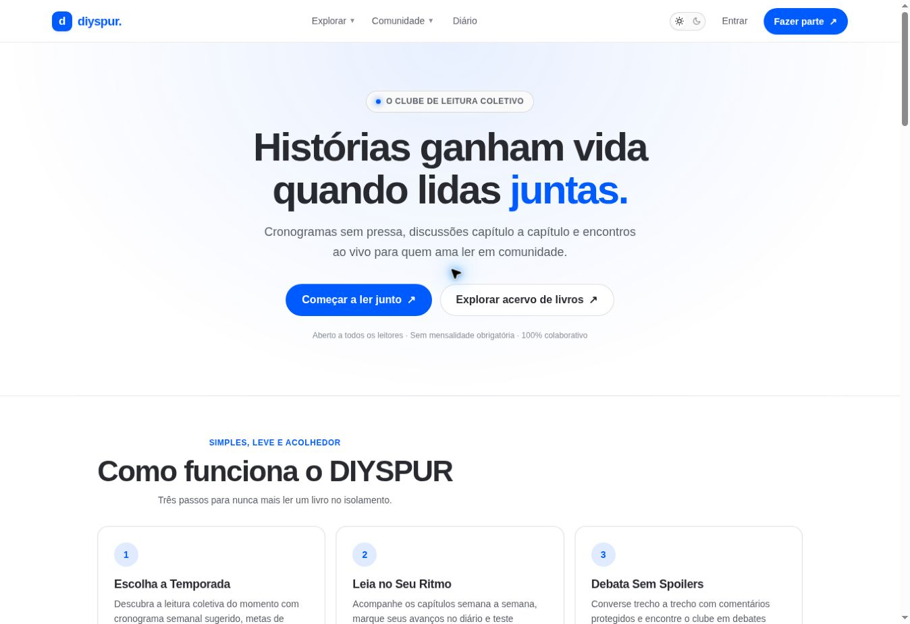

# DIYSPUR — manual do usuário e índice técnico

**Rodada:** 12/10/2026, horário de Brasília. **Idioma:** português do Brasil. **Aplicação:** https://diyspur.vercel.app/.

Este manual explica a versão inspecionada no navegador e no código. Capturas são reais; estados e conteúdo podem mudar. A publicação do manual não equivale a aprovação de todos os fluxos para produção. Salvamentos não executados, ausência de conta admin e testes responsivos pendentes estão explicitados na [matriz QA](03-qa-coverage.md).

## Como usar

Comece por [Primeiros passos](01-getting-started.md). Use a tabela para encontrar a tela desejada. Cada guia separa propósito, acesso, interface, passos, backend e situações de erro. Para implementação e autorização, leia [Referência técnica](02-technical-reference.md), [RLS](04-rls-reference.md) e [Achados e melhorias](05-findings.md).

## Produto e arquitetura

DIYSPUR é a segunda tela de um clube literário: descoberta de livros, temporadas de leitura coletiva, vídeos/discussões, quizzes, encontros e organização do leitor. O usuário lê seu exemplar físico/digital; o site não fornece download integral das obras.

| Camada | Implementação e responsabilidade |
|---|---|
| Frontend | Next.js App Router 16.4.0, React 19.3.0, TypeScript; páginas em src/app; CSS próprio |
| Leitura no servidor | Server Components e queries com Supabase SSR; credenciais públicas de cliente não substituem autorização |
| Interação | Client Components para formulários, menus, spoilers e player; Server Actions validam entradas/sessão |
| Identidade | Supabase Auth, getClaims, cookies SSR e renovação no proxy |
| Persistência | PostgreSQL/Supabase com tabelas, views, RPCs e RLS; 82 tabelas public consultadas com RLS habilitada |
| Processamento | Edge Functions para quiz-validate, award-xp e vote-next-book conforme integração no código |
| Externos | YouTube sob interação, Amazon por redirect afiliado, Google Agenda/ICS; analytics opcional |

**Código inspecionado:** app `8a5bcd75ac23d1a7030d804deae146c39fb6d7e6`; db `3d9bf1a14edea87173a346225d84f55558d64a39`. Esses hashes fixam as fontes consultadas, não comprovam qual commit a Vercel implantou. O comportamento live é documentado separadamente.

## Rotas e módulos

Public significa que há shell/conteúdo acessível sem sessão; Authenticated significa dados ou ações pessoais. Há páginas mistas. Por exemplo, /listas e /leituras-compartilhadas oferecem shell público com convite ao login; /notificacoes efetivamente redireciona pelo proxy. /desafios permite consultar ciclos públicos, e /ranking exige sessão. Essas distinções substituem classificações simplificadas do README anterior.

| Rota | Acesso efetivo / contrato | Finalidade | Guia |
|---|---|---|---|
| `/` | Public | Apresentar o clube, a leitura coletiva em destaque e os caminhos para começar a participar. | [Início](pages/home.md) |
| `/livros` | Public | Descobrir o acervo e localizar títulos por nome. | [Catálogo de livros](pages/livros.md) |
| `/livros/[slug]` | Public | Entender a obra, a edição, os avisos de conteúdo e as temporadas, e guardar o título na organização pessoal. | [Ficha do livro](pages/livro.md) |
| `/temporadas/[slug]` | Public; conteúdo condicionado | Organizar a leitura coletiva em etapas e mostrar quais capítulos podem ser abertos. | [Temporada e cronograma](pages/temporada.md) |
| `/capitulos/[id]` | Public / Authenticated; gate por capítulo | Acompanhar uma etapa da leitura, participar da discussão e registrar o próprio avanço. | [Capítulo: vídeo, progresso, conversa e quiz](pages/capitulo.md) |
| `/calendario` | Public / Authenticated | Consultar encontros e organizar a participação no horário correto. | [Calendário e presença](pages/calendario.md) |
| `/votacao` | Public / Authenticated | Permitir escolhas coletivas e consultar decisões anteriores. | [Votação da próxima leitura](pages/votacao.md) |
| `/comunidade` | Public | Descobrir discussões com contexto do capítulo e proteção visual de spoiler. | [Conversas da comunidade](pages/comunidade.md) |
| `/clubes` | Public / Authenticated | Encontrar espaços de leitura e abrir a ficha de um clube. | [Descobrir clubes](pages/clubes.md) |
| `/clubes/novo` | Authenticated | Criar um espaço público ou privado para uma turma de leitores. | [Criar clube](pages/clube-novo.md) |
| `/clubes/[slug]` | Public / Authenticated / Owner | Consultar o espaço, participar e acompanhar o ciclo definido pelo responsável. | [Ficha e gestão do clube](pages/clube.md) |
| `/perfil` | Authenticated | Reunir indicadores pessoais, leituras recentes, quizzes, conquistas e acesso aos dados. | [Meu espaço](pages/perfil.md) |
| `/historico` | Authenticated | Retomar capítulos e verificar conclusão e resultados de quiz. | [Histórico de leitura](pages/historico.md) |
| `/diario` | Authenticated | Guardar anotações privadas e medidas de uma sessão de leitura. | [Diário de leitura](pages/diario.md) |
| `/listas` | Authenticated; shell público | Organizar títulos em listas próprias e consultar conteúdo compartilhado autorizado. | [Listas de leitura](pages/listas.md) |
| `/metas` | Authenticated | Definir objetivos de livros, páginas e tempo e comparar com a leitura registrada. | [Metas anuais](pages/metas.md) |
| `/minha-fila` | Authenticated | Priorizar até cinco títulos para ler a seguir. | [Fila de próximos livros](pages/minha-fila.md) |
| `/leituras-compartilhadas` | Authenticated; shell público | Consultar grupos de leitura e seus checkpoints autorizados. | [Leituras compartilhadas](pages/leituras-compartilhadas.md) |
| `/notificacoes` | Authenticated | Consultar atualizações pessoais e responder convites de clubes. | [Notificações e convites](pages/notificacoes.md) |
| `/desafios` | Public / Authenticated | Descobrir desafios publicados e acompanhar a participação pessoal. | [Desafios de leitura](pages/desafios.md) |
| `/ranking` | Authenticated | Consultar posições por XP na temporada ativa. | [Ranking da temporada](pages/ranking.md) |
| `/entrar` | Public; redireciona autenticados | Acessar a conta por senha ou link de acesso e voltar à página solicitada. | [Entrar na comunidade](pages/entrar.md) |
| `/cadastro` | Public; redireciona autenticados | Criar identidade de leitor e iniciar participação pessoal. | [Criar conta](pages/cadastro.md) |
| `/recuperar-senha` | Public | Solicitar instruções para recuperar a senha sem revelar se uma conta existe. | [Recuperar acesso](pages/recuperar-senha.md) |
| `/atualizar-senha` | Shell público; ação requer sessão válida | Definir uma nova senha depois da recuperação autorizada. | [Atualizar senha](pages/atualizar-senha.md) |
| `/termos` | Public | Consultar regras de uso, segurança da conta, propriedade intelectual e transparência de afiliados. | [Termos e convivência](pages/termos.md) |
| `/privacidade` | Public | Explicar tratamento de dados e permitir consultar orientações de privacidade. | [Privacidade e preferências](pages/privacidade.md) |
| `/admin` | Admin | Concentrar os caminhos de operação editorial e moderação. | [Painel administrativo](pages/admin.md) |
| `/admin/books` | Admin | Manter os títulos e a ficha editorial do catálogo. | [Cadastro e edição editorial de livros](pages/admin-books.md) |
| `/admin/seasons/[id]` | Admin | Editar ciclo, trechos, replay e agendamento de capítulos existentes. | [Editor de temporada e capítulos](pages/admin-season.md) |
| `/admin/moderation` | Admin | Revisar denúncias e decidir medidas sobre conteúdo da comunidade. | [Fila de moderação](pages/admin-moderation.md) |

O entrypoint dinâmico `src/app/[memberPage]/page.tsx` é fallback para ranking/desafios/notificacoes/historico; as rotas estáticas específicas prevalecem. Ele não cria um painel adicional nem significa que qualquer nome arbitrário de página seja válido. Não foram encontradas páginas /dashboard ou /settings dedicadas.

## Endereços concretos visitados

| Tipo | Exemplos auditados |
|---|---|
| Livros | /livros/verity; /livros/o-massacre-da-familia-hope |
| Temporada | /temporadas/t1-verity |
| Capítulos | /capitulos/3a687744-7a0f-4dbf-9bad-f5ad3d920732; /capitulos/b3364a2b-dd1d-4e32-9ba6-4d8aa99954ee; /capitulos/ef16a59a-0f08-484e-873f-16f74b1442b0 |
| Clube | /clubes/clube-ae595cd137d748619dfcabf7e7848fa0 |
| Editor | /admin/seasons/626f6db0-c40f-4ed2-8723-c57c1bd2993a — acesso negado ao leitor |
| Estados | /livros?q=zzqa-inexistente; /diario?tab=arquivados; redirects anônimos em páginas pessoais |

## Endpoints que não são telas

| Endpoint | Método | Finalidade | Validação desta rodada |
|---|---|---|---|
| /auth/callback | GET | Trocar código Auth por sessão e voltar ao destino local | Código; e-mail/link não exercitados |
| /auth/signout | POST | Encerrar sessão e voltar à home com 303 | Logout executado no navegador |
| /api/ics/[meetingId] | GET | Exportar encontro em iCalendar | Download .ics confirmado; importação externa pendente |
| /api/affiliate/[slug] | GET | Validar destino afiliado e redirecionar | Código; clique externo não executado |
| /api/account/export | GET | Exportar subconjunto dos dados próprios em JSON | Código e link no perfil; download pendente |
| /api/health | GET | Diagnóstico da aplicação | Inventário de código; não certificado pelo navegador |

## Navegação e acessibilidade

Desktop: Explorar → catálogo/clubes; Comunidade → espaços coletivos; Meu ritmo e Meu espaço → área pessoal. O perfil fornece dez links canônicos. Sem sessão, cabeçalho oferece Entrar e Fazer parte. No mobile, o código inclui menu adaptativo; testes visuais e de toque nos seis breakpoints seguem pendentes.

Use o link Pular para o conteúdo para saltar a navegação. Formulários têm rótulos; erros/status são anunciados por roles em componentes. A home desktop inspecionada apresentou um único main e largura sem overflow. Não foi executada auditoria WCAG integral nem avaliação por leitor de tela real.

