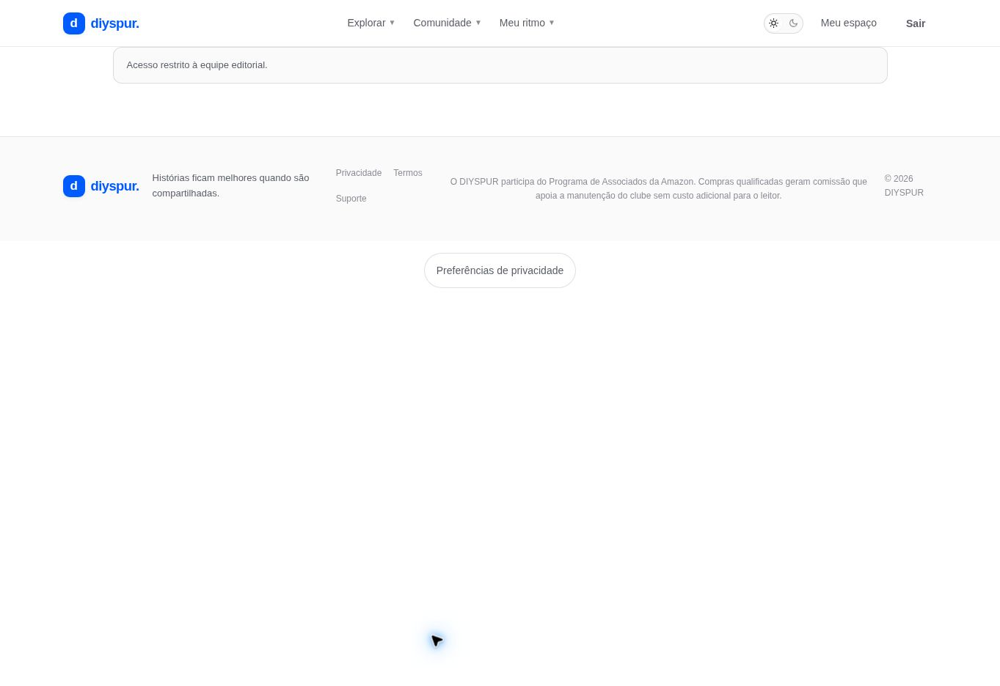

# Fila de moderação / `/admin/moderation`

## 1. Overview & Purpose

- **URL Path:** `/admin/moderation`
- **Access Level:** Admin
- **Core Purpose:** Revisar denúncias e decidir medidas sobre conteúdo da comunidade.

## 2. Prerequisites & Access

Administrador e denúncia pendente para fila preenchida.

## 3. UI Components & Layout

Conforme código: fila com tipo/ID/motivo/data; Ocultar e resolver; Resolver; Dispensar; estado Fila limpa.

*Captura real do estado disponível nesta rodada. Em telas administrativas, a imagem mostra o bloqueio de uma conta comum; não representa o editor autorizado.*

## 4. Step-by-Step User Flow

1. **Step 1:** Abra **Moderação** no painel.
2. **Step 2:** Leia o motivo e identifique o conteúdo relacionado antes de decidir.
3. **Step 3:** Escolha **Ocultar e resolver** para ocultar o conteúdo reportado e resolver a denúncia pela RPC.
4. **Step 4:** Use **Resolver** para fechar o caso sem a ação de ocultação, ou **Dispensar** quando a denúncia não procede.
5. **Step 5:** Aguarde feedback e confirme a saída da fila pendente. Não confundir dispensar denúncia com excluir a publicação.

### Interação com o backend

Consulta content_reports status pending limitada a 100. review_content_report altera estado revisado; hide_reported_content aplica a ação autorizada sobre o conteúdo.

Os passos de salvamento acima descrevem o contrato implementado. Confirme a mensagem de sucesso antes de considerar uma operação persistida; sua execução nesta rodada está indicada abaixo.

## 5. Error Handling & Edge Cases

Sem permissão, bloqueio. Fila vazia mostra Fila limpa. Falha de consulta exibe aviso. O frontend atual identifica conteúdo por ID e motivo; a decisão exige contexto que pode requerer abrir o capítulo correspondente.

### Evidência e limite desta rodada

Somente bloqueio de acesso ao leitor observado; nenhuma denúncia criada ou revisada.

Falhas de rede forçadas, comparação entre duas contas e matriz mobile/tablet não executadas nesta sessão. Layout responsivo foi revisado no CSS, sem certificação visual desses tamanhos. Consulte [cobertura QA](../03-qa-coverage.md).

### Referência de implementação

- [src/app/admin/moderation/page.tsx](../../../src/app/admin/moderation/page.tsx)
- [src/components/admin/admin-controls.tsx](../../../src/components/admin/admin-controls.tsx)
- [src/app/admin/actions.ts](../../../src/app/admin/actions.ts)

[Índice do manual](../00-overview.md) · [Primeiros passos](../01-getting-started.md) · [Referência técnica](../02-technical-reference.md)
