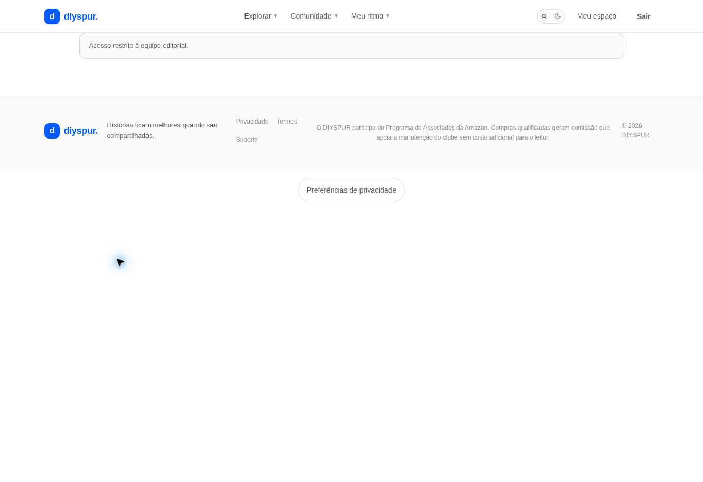

# Editor de temporada e capítulos / `/admin/seasons/[id]`

## 1. Overview & Purpose

- **URL Path:** `/admin/seasons/[id]`
- **Access Level:** Admin
- **Core Purpose:** Editar ciclo, trechos, replay e agendamento de capítulos existentes.

## 2. Prerequisites & Access

Administrador e UUID de temporada existente; conteúdo e quiz revisados antes de publicação.

## 3. UI Components & Layout

Conforme código: editor de temporada com título, descrição/status; editores de capítulos com título, leitura, resumo, replay e Publicar em.

*Captura real do estado disponível nesta rodada. Em telas administrativas, a imagem mostra o bloqueio de uma conta comum; não representa o editor autorizado.*

## 4. Step-by-Step User Flow

1. **Step 1:** Abra a temporada existente por seu UUID no editor.
2. **Step 2:** Revise título, descrição e status: Planejada, Inscrições, Ativa ou Finalizada. Use **Salvar temporada**.
3. **Step 3:** No capítulo, revise título, trecho de leitura e resumo.
4. **Step 4:** Informe replay válido do YouTube e a data/hora local em **Publicar em** quando quiser agendar/publicar.
5. **Step 5:** Antes de publicar, assegure exatamente cinco perguntas revisadas, alternativas válidas, índice correto e referência de leitura preenchida. O editor atual não oferece CRUD de perguntas nesta tela.
6. **Step 6:** Use **Salvar capítulo**. Sem data, a action deriva rascunho; com data/replay/quiz válidos, confirma publicação/agendamento.
7. **Step 7:** Confira a página pública e a timeline usando também uma conta de leitor para verificar a visibilidade.

### Interação com o backend

updateSeason escreve seasons; updateChapter escreve chapters, published_at e is_draft. Antes de publicação consulta quiz_questions e registra editorial_audit_log. Campo datetime-local é convertido para ISO; toLocalDateTime evita usar UTC como hora local no preenchimento.

Os passos de salvamento acima descrevem o contrato implementado. Confirme a mensagem de sucesso antes de considerar uma operação persistida; sua execução nesta rodada está indicada abaixo.

## 5. Error Handling & Edge Cases

Sem admin há bloqueio. Temporada inexistente para admin gera notFound. Falta de replay ou cinco perguntas válidas impede publicação. Data/hora segue fuso do dispositivo do operador, não automaticamente Brasília. Não existe formulário de criar temporada/capítulo nesta página.

### Evidência e limite desta rodada

Editor da temporada Verity negado à conta de leitor. Contratos de publicação lidos no código; nenhum conteúdo alterado.

Falhas de rede forçadas, comparação entre duas contas e matriz mobile/tablet não executadas nesta sessão. Layout responsivo foi revisado no CSS, sem certificação visual desses tamanhos. Consulte [cobertura QA](../03-qa-coverage.md).

### Referência de implementação

- [src/app/admin/seasons/[id]/page.tsx](../../../src/app/admin/seasons/[id]/page.tsx)
- [src/components/admin/admin-controls.tsx](../../../src/components/admin/admin-controls.tsx)
- [src/app/admin/actions.ts](../../../src/app/admin/actions.ts)

[Índice do manual](../00-overview.md) · [Primeiros passos](../01-getting-started.md) · [Referência técnica](../02-technical-reference.md)
