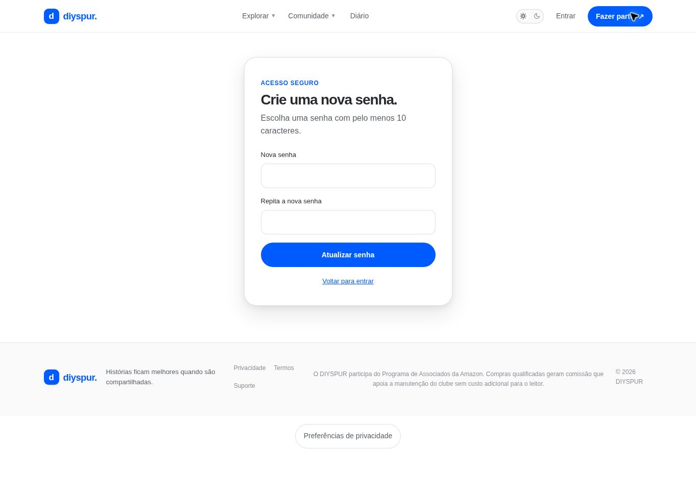

# Atualizar senha / `/atualizar-senha`

## 1. Overview & Purpose

- **URL Path:** `/atualizar-senha`
- **Access Level:** Shell público; ação requer sessão válida
- **Core Purpose:** Definir uma nova senha depois da recuperação autorizada.

## 2. Prerequisites & Access

Link de recuperação válido ou sessão reconhecida pelo Supabase. Abrir a tela sozinha não valida recuperação.

## 3. UI Components & Layout

Nova senha; Repita a nova senha; Atualizar senha; feedback; retorno ao login.

*Captura real do estado disponível nesta rodada. Em telas administrativas, a imagem mostra o bloqueio de uma conta comum; não representa o editor autorizado.*

## 4. Step-by-Step User Flow

1. **Step 1:** Chegue à tela pelo link de recuperação recebido no seu e-mail.
2. **Step 2:** Informe uma senha com 10–128 caracteres e repita exatamente a mesma senha.
3. **Step 3:** Clique em **Atualizar senha**. O Supabase valida a sessão antes de alterar a credencial.
4. **Step 4:** Com confirmação Senha atualizada…, a aplicação retorna ao destino local informado ou ao perfil.

### Interação com o backend

auth.updateUser({password}) no cliente browser; redirecionamento local após confirmação.

Os passos de salvamento acima descrevem o contrato implementado. Confirme a mensagem de sucesso antes de considerar uma operação persistida; sua execução nesta rodada está indicada abaixo.

## 5. Error Handling & Edge Cases

Tela também renderiza sem sessão: o salvamento é que depende do Auth. Senhas divergentes retornam As senhas precisam ser iguais. Falha orienta solicitar nova recuperação. Não afirmar que abrir a URL basta para trocar credencial.

### Evidência e limite desta rodada

Shell sem sessão observado. Nenhum campo de senha preenchido ou credencial alterada.

Falhas de rede forçadas, comparação entre duas contas e matriz mobile/tablet não executadas nesta sessão. Layout responsivo foi revisado no CSS, sem certificação visual desses tamanhos. Consulte [cobertura QA](../03-qa-coverage.md).

### Referência de implementação

- [src/app/atualizar-senha/page.tsx](../../../src/app/atualizar-senha/page.tsx)
- [src/components/update-password-form.tsx](../../../src/components/update-password-form.tsx)

[Índice do manual](../00-overview.md) · [Primeiros passos](../01-getting-started.md) · [Referência técnica](../02-technical-reference.md)
