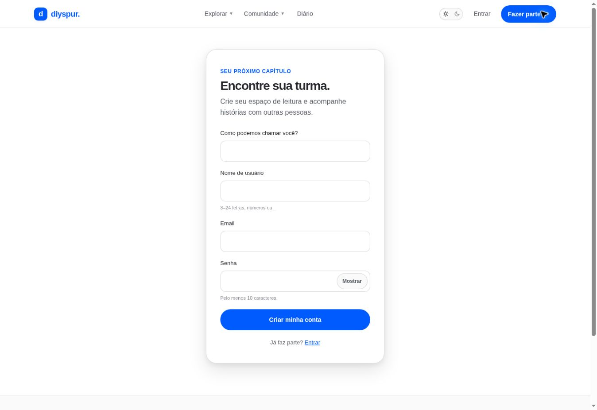

# Criar conta / `/cadastro`

## 1. Overview & Purpose

- **URL Path:** `/cadastro`
- **Access Level:** Public; redireciona autenticados
- **Core Purpose:** Criar identidade de leitor e iniciar participação pessoal.

## 2. Prerequisites & Access

E-mail acessível e escolha de nome/@usuário. Conferir termos e privacidade.

## 3. UI Components & Layout

Nome de exibição; Nome de usuário; Email; Senha; Mostrar/Ocultar; Criar minha conta; link Entrar.

### Campos e regras

| Campo | Regra | Como usar |
|---|---|---|
| Nome | 2–80 caracteres na experiência | Nome de exibição |
| Usuário | 3–24, a-z 0-9 _ | Sem espaços/acentos |
| Email | Formato válido | Até 254 no campo |
| Senha | 10–128 caracteres | Não incluir no manual ou em prints |

*Captura real do estado disponível nesta rodada. Em telas administrativas, a imagem mostra o bloqueio de uma conta comum; não representa o editor autorizado.*

## 4. Step-by-Step User Flow

1. **Step 1:** Abra **Fazer parte**.
2. **Step 2:** Preencha **Como podemos chamar você?** com pelo menos dois caracteres.
3. **Step 3:** Escolha **Nome de usuário** com 3–24 letras sem acentos, números ou sublinhado; o código normaliza para minúsculas.
4. **Step 4:** Informe e-mail válido e senha com pelo menos dez caracteres.
5. **Step 5:** Use **Criar minha conta**. Quando o Supabase não devolver sessão imediata, a tela pede confirmação por e-mail.
6. **Step 6:** Abra a mensagem de confirmação e siga o link; o callback cria a sessão e retorna ao destino local.
7. **Step 7:** Depois, consulte um livro, a temporada e o primeiro capítulo. O código não exige um wizard adicional de preferências.

### Interação com o backend

auth.signUp envia display_name e username como metadados de cadastro. Esses metadados não concedem papel administrativo. Confirmação depende da configuração do Supabase Auth; ausência de sessão gera mensagem Quase lá: confira seu email….

Os passos de salvamento acima descrevem o contrato implementado. Confirme a mensagem de sucesso antes de considerar uma operação persistida; sua execução nesta rodada está indicada abaixo.

## 5. Error Handling & Edge Cases

E-mail inválido, senha curta e usuário fora do padrão impedem envio. Prévia read-only pode desabilitar cadastro. E-mail existente, confirmação e envio efetivo dependem do serviço; não testados nesta rodada.

### Evidência e limite desta rodada

Formulário e regras exibidas inspecionados. Nenhuma nova conta criada; confirmação por e-mail descrita pelo código e não como teste E2E concluído.

Falhas de rede forçadas, comparação entre duas contas e matriz mobile/tablet não executadas nesta sessão. Layout responsivo foi revisado no CSS, sem certificação visual desses tamanhos. Consulte [cobertura QA](../03-qa-coverage.md).

### Referência de implementação

- [src/app/cadastro/page.tsx](../../../src/app/cadastro/page.tsx)
- [src/components/auth-form.tsx](../../../src/components/auth-form.tsx)
- [src/lib/safe-redirect.ts](../../../src/lib/safe-redirect.ts)
- [src/app/auth/callback/route.ts](../../../src/app/auth/callback/route.ts)

[Índice do manual](../00-overview.md) · [Primeiros passos](../01-getting-started.md) · [Referência técnica](../02-technical-reference.md)
