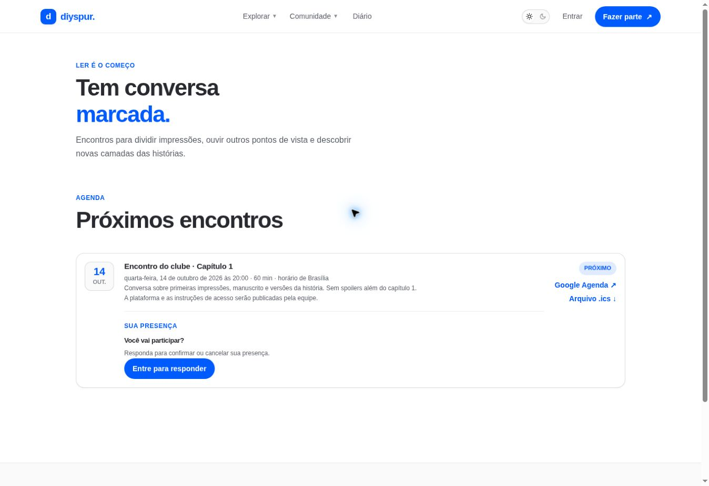

# Calendário e presença / `/calendario`

## 1. Overview & Purpose

- **URL Path:** `/calendario`
- **Access Level:** Public / Authenticated
- **Core Purpose:** Consultar encontros e organizar a participação no horário correto.

## 2. Prerequisites & Access

Sem conta para ler a agenda e exportar evento. Sessão para confirmar/cancelar presença.

## 3. UI Components & Layout

Próximos encontros; data, duração e horário de Brasília; pauta; instruções; resposta de presença; Google Agenda; arquivo .ics.

*Captura desktop sem sessão. A imagem mostra o estado público ou o convite de acesso. As funções pessoais descritas exigem sessão.*

## 4. Step-by-Step User Flow

1. **Step 1:** Abra **Comunidade → Calendário** ou **Ver todos →** na home.
2. **Step 2:** Confira data, horário de Brasília, duração, pauta e plataforma. Se o link ainda não estiver publicado, aguarde a equipe.
3. **Step 3:** Com sessão ativa, selecione **Aceitar** para registrar intenção de participação; **Cancelar** altera essa resposta.
4. **Step 4:** Espere a confirmação de presença ou a mensagem de erro. A atualização usa o mesmo registro do leitor e encontro.
5. **Step 5:** Use **Google Agenda ↗** para preparar o evento em outro serviço ou **Arquivo .ics ↓** para importar no calendário que utiliza. Exportar não equivale a confirmar RSVP.
6. **Step 6:** No horário do encontro, retorne ao calendário e use o acesso publicado pela equipe.

### Interação com o backend

getMeetings/getUpcomingMeetings leem meetings; setMeetingRsvp faz upsert em meeting_rsvps e deriva user_id da sessão. /api/ics/[meetingId] produz text/calendar; Google Agenda recebe um template com horário em UTC.

Os passos de salvamento acima descrevem o contrato implementado. Confirme a mensagem de sucesso antes de considerar uma operação persistida; sua execução nesta rodada está indicada abaixo.

## 5. Error Handling & Edge Cases

Encontro sem meeting_url informa que a equipe publicará instruções. Não prometa link antes de existir. Sessão expirada ou erro no upsert mostra falha e exige revisar o estado. A presença e os horários não são alterados por importar ICS.

### Evidência e limite desta rodada

Encontro exibido para 14/10/2026 às 20h Brasília, duração 60 min, sem acesso publicado. A sessão já tinha presença cancelada; não foi alterada. Download .ics executado: DTSTART 20261014T230000Z e DTEND 20261015T000000Z, 16 separadores CRLF reais. Importação em calendário externo não executada.

Falhas de rede forçadas, comparação entre duas contas e matriz mobile/tablet não executadas nesta sessão. Layout responsivo foi revisado no CSS, sem certificação visual desses tamanhos. Consulte [cobertura QA](../03-qa-coverage.md).

### Referência de implementação

- [src/app/calendario/page.tsx](../../../src/app/calendario/page.tsx)
- [src/features/meetings/rsvp-actions.ts](../../../src/features/meetings/rsvp-actions.ts)
- [src/components/calendar/meeting-rsvp.tsx](../../../src/components/calendar/meeting-rsvp.tsx)
- [src/app/api/ics/[meetingId]/route.ts](../../../src/app/api/ics/[meetingId]/route.ts)

[Índice do manual](../00-overview.md) · [Primeiros passos](../01-getting-started.md) · [Referência técnica](../02-technical-reference.md)
