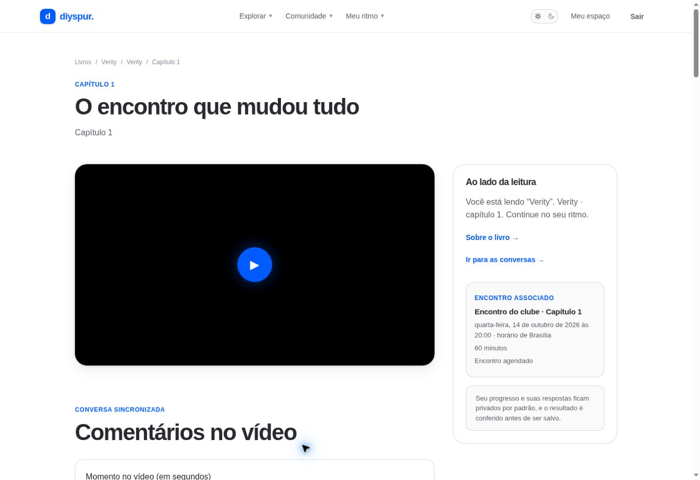

# Capítulo: vídeo, progresso, conversa e quiz / `/capitulos/[id]`

## 1. Overview & Purpose

- **URL Path:** `/capitulos/[id]`
- **Access Level:** Public / Authenticated; gate por capítulo
- **Core Purpose:** Acompanhar uma etapa da leitura, participar da discussão e registrar o próprio avanço.

## 2. Prerequisites & Access

Capítulo publicado e autorizado pela sequência. Sessão ativa para comentar, registrar progresso, responder quiz e pergunta do anfitrião. Ter o exemplar ajuda a acompanhar o trecho editorial.

## 3. UI Components & Layout

Breadcrumbs; título/trecho; fachada do vídeo; comentários com segundos; progresso; conversa do capítulo; pergunta do anfitrião; quiz; anterior/próximo; informações da temporada e encontro.

### Campos e regras

| Campo | Regra | Como usar |
|---|---|---|
| Comentário | 1–4000 caracteres no fluxo de edição | Não informe dados pessoais; marque spoiler |
| Momento do vídeo | Segundos | Leia o tempo no vídeo; não use mm:ss no campo numérico |
| Progresso | Estimativa percentual | Concluir grava 100%; conclusão não regride |
| Quiz | Uma alternativa por pergunta | Score calculado no backend, não no navegador |

*Captura real do estado disponível nesta rodada. Em telas administrativas, a imagem mostra o bloqueio de uma conta comum; não representa o editor autorizado.*

## 4. Step-by-Step User Flow

1. **Step 1:** Abra o capítulo pelo cronograma. Se a página informar bloqueio, siga o login e o quiz anterior antes de voltar.
2. **Step 2:** Leia o trecho proposto no seu exemplar e use **Assistir vídeo** quando quiser carregar o player externo do YouTube.
3. **Step 3:** Para comentário sincronizado, informe o momento em segundos: 1 min 30 s corresponde a 90. Escreva a impressão, marque spoiler quando necessário e use **Comentar neste momento**.
4. **Step 4:** Na seção de progresso, ajuste o avanço estimado e use **Salvar progresso**. Para terminar a etapa, escolha **Concluir capítulo**; a conclusão registra 100%.
5. **Step 5:** Na conversa do capítulo, escreva o comentário e marque **Este comentário contém spoiler** quando revelar enredo; use **Publicar comentário**.
6. **Step 6:** Comentários protegidos oferecem **Revelar comentário**. Leia o aviso antes de revelar; isso muda apenas a exibição local.
7. **Step 7:** Se o comentário for seu, use **Editar**, revise o texto e salve. **Remover** segue a operação de remoção própria do backend. Para outro conteúdo inadequado, use **Denunciar**, informe o motivo e revise antes de enviar.
8. **Step 8:** Na **Pergunta do anfitrião**, escolha uma das alternativas e use **Responder** ou **Atualizar resposta**. O resultado exibido é agregado.
9. **Step 9:** Responda todas as perguntas do **Quiz do capítulo**. **Enviar respostas** fica desabilitado enquanto falta uma resposta. O resultado é validado no backend; uma tentativa registrada pode liberar a etapa seguinte conforme o contrato.
10. **Step 10:** Use **Próximo capítulo** ou **Capítulo anterior** e consulte /historico para acompanhar o resultado persistido.

### Interação com o backend

getChapters consulta chapters, seasons, books, v_comments_visible, user_progress, v_quiz_questions_public, host_prompts, v_host_prompt_results e host_prompt_votes. Comentário insere comments; progresso faz upsert(user_id,chapter_id); quiz invoca quiz-validate com token e Idempotency-Key; conclusão/comentário invocam award-xp. Comentário sincronizado insere video_timed_comments e leitura usa get_visible_video_timed_comments. Denúncias usam report_content.

Os passos de salvamento acima descrevem o contrato implementado. Confirme a mensagem de sucesso antes de considerar uma operação persistida; sua execução nesta rodada está indicada abaixo.

## 5. Error Handling & Edge Cases

Gate anônimo observado nos capítulos 2 e 3. Após conclusão, progresso não pode regredir pelo fluxo atual. Falha de XP pode deixar a atividade salva com mensagem de sincronização pendente. Falha de quiz não confirma respostas; limite pode pedir espera de um minuto. Sessão expirada pede login. Vídeo indisponível não deve ser interpretado como perda do progresso.

### Evidência e limite desta rodada

Três capítulos visitados autenticados. Capítulo 1 já concluído, respostas do anfitrião existentes e quiz com cinco perguntas. Capítulos 2/3 sem progresso nem comentários. Botão de quiz desabilitado sem respostas. Persistência, player e novo envio não executados nesta rodada.

Falhas de rede forçadas, comparação entre duas contas e matriz mobile/tablet não executadas nesta sessão. Layout responsivo foi revisado no CSS, sem certificação visual desses tamanhos. Consulte [cobertura QA](../03-qa-coverage.md).

### Referência de implementação

- [src/app/capitulos/[id]/page.tsx](../../../src/app/capitulos/[id]/page.tsx)
- [src/features/chapters/actions.ts](../../../src/features/chapters/actions.ts)
- [src/features/chapters/schemas.ts](../../../src/features/chapters/schemas.ts)
- [src/features/catalog/queries.ts](../../../src/features/catalog/queries.ts)
- [src/features/video-comments/actions.ts](../../../src/features/video-comments/actions.ts)
- [src/features/host-prompts/actions.ts](../../../src/features/host-prompts/actions.ts)
- [src/features/moderation/actions.ts](../../../src/features/moderation/actions.ts)

[Índice do manual](../00-overview.md) · [Primeiros passos](../01-getting-started.md) · [Referência técnica](../02-technical-reference.md)
