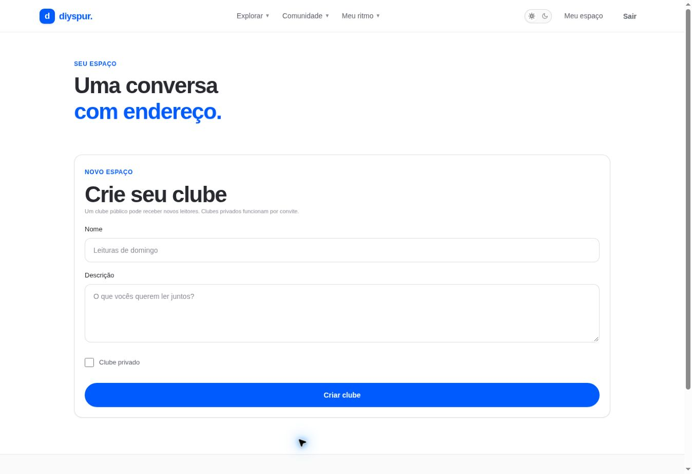

# Criar clube / `/clubes/novo`

## 1. Overview & Purpose

- **URL Path:** `/clubes/novo`
- **Access Level:** Authenticated
- **Core Purpose:** Criar um espaço público ou privado para uma turma de leitores.

## 2. Prerequisites & Access

Sessão ativa; decidir nome, descrição e privacidade antes de salvar.

## 3. UI Components & Layout

Formulário Nome; Descrição; Clube privado; Criar clube; mensagem de resultado.

*Captura real do estado disponível nesta rodada. Em telas administrativas, a imagem mostra o bloqueio de uma conta comum; não representa o editor autorizado.*

## 4. Step-by-Step User Flow

1. **Step 1:** Abra **Criar um clube** na listagem.
2. **Step 2:** Informe um nome que identifique o grupo e uma descrição sobre sua proposta.
3. **Step 3:** Marque **Clube privado** se o acesso deve ocorrer por convite; público pode receber novos leitores.
4. **Step 4:** Pressione **Criar clube** uma vez e aguarde o resultado. A action envia requestId para evitar duplicação do mesmo pedido.
5. **Step 5:** Após confirmação, volte à listagem e abra a ficha do clube para gerenciar o espaço.

### Interação com o backend

createClub valida createClubSchema, exige sessão e chama create_user_club com p_name, p_description, p_private e p_request_id.

Os passos de salvamento acima descrevem o contrato implementado. Confirme a mensagem de sucesso antes de considerar uma operação persistida; sua execução nesta rodada está indicada abaixo.

## 5. Error Handling & Edge Cases

Nome/descrição inválidos retornam Revise nome, descrição e privacidade. Sessão ausente redireciona ao login. Falha de rede deve ser tratada pelo resultado antes de iniciar outra criação.

### Evidência e limite desta rodada

Formulário renderizado autenticado; acesso sem sessão redirecionou para login preservando /clubes/novo. Criação não enviada.

Falhas de rede forçadas, comparação entre duas contas e matriz mobile/tablet não executadas nesta sessão. Layout responsivo foi revisado no CSS, sem certificação visual desses tamanhos. Consulte [cobertura QA](../03-qa-coverage.md).

### Referência de implementação

- [src/app/clubes/novo/page.tsx](../../../src/app/clubes/novo/page.tsx)
- [src/components/clubs/club-form.tsx](../../../src/components/clubs/club-form.tsx)
- [src/features/clubs/actions.ts](../../../src/features/clubs/actions.ts)
- [src/features/clubs/schemas.ts](../../../src/features/clubs/schemas.ts)

[Índice do manual](../00-overview.md) · [Primeiros passos](../01-getting-started.md) · [Referência técnica](../02-technical-reference.md)
