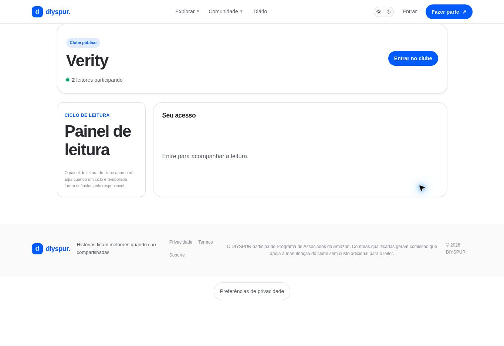

# Ficha e gestão do clube / `/clubes/[slug]`

## 1. Overview & Purpose

- **URL Path:** `/clubes/[slug]`
- **Access Level:** Public / Authenticated / Owner
- **Core Purpose:** Consultar o espaço, participar e acompanhar o ciclo definido pelo responsável.

## 2. Prerequisites & Access

Clube público ou autorização para privado. Sessão para entrada/saída. Ser titular para edição, convites e gestão de membros.

## 3. UI Components & Layout

Nome/privacidade; contagem; Entrar/Sair; Painel de leitura; Seu acesso; controles do titular quando autorizados.

*Captura desktop sem sessão. A imagem mostra o estado público ou o convite de acesso. As funções pessoais descritas exigem sessão.*

## 4. Step-by-Step User Flow

1. **Step 1:** Abra a ficha pela listagem e confira se o clube é público ou privado.
2. **Step 2:** Se for público e você quiser participar, use **Entrar no clube** e aguarde confirmação.
3. **Step 3:** Consulte o painel de leitura. Sem temporada definida, o aviso orienta aguardar o responsável.
4. **Step 4:** Se você for responsável, abra a gestão para editar nome, descrição, privacidade e temporada associada, depois salve.
5. **Step 5:** Para convidar, informe o nome de usuário do leitor. O sistema localiza o perfil público e cria convite com expiração de sete dias.
6. **Step 6:** O convidado consulta notificações e aceita o convite. O responsável pode revogar convite ou remover membro pelos controles autorizados.
7. **Step 7:** Para deixar o clube, use a ação de saída quando disponível e revise o feedback; regras do proprietário são decididas no backend.

### Interação com o backend

Queries em user_clubs, user_club_members e seasons. RPCs create/join/leave/update_user_club; invite_user_to_club; accept_club_invitation; revoke_club_invitation; remove_club_member. update usa p_version para concorrência; lookup de convite em v_profiles_public.

Os passos de salvamento acima descrevem o contrato implementado. Confirme a mensagem de sucesso antes de considerar uma operação persistida; sua execução nesta rodada está indicada abaixo.

## 5. Error Handling & Edge Cases

Privado não autorizado ou slug ausente pode resultar em não encontrado. Usuário não localizado gera mensagem. Convite expirado/revogado não garante ingresso. Conflito de versão exige atualizar antes de editar. Não confundir contagem com lista completa de dados pessoais.

### Evidência e limite desta rodada

Clube Verity: dois participantes, botão Entrar no clube e painel sem ciclo. Não houve ingresso, saída ou convite nesta rodada; controles do titular descritos pelo código.

Falhas de rede forçadas, comparação entre duas contas e matriz mobile/tablet não executadas nesta sessão. Layout responsivo foi revisado no CSS, sem certificação visual desses tamanhos. Consulte [cobertura QA](../03-qa-coverage.md).

### Referência de implementação

- [src/app/clubes/[slug]/page.tsx](../../../src/app/clubes/[slug]/page.tsx)
- [src/features/clubs/queries.ts](../../../src/features/clubs/queries.ts)
- [src/features/clubs/actions.ts](../../../src/features/clubs/actions.ts)
- [src/components/clubs/club-management.tsx](../../../src/components/clubs/club-management.tsx)
- [src/components/clubs/club-invitations.tsx](../../../src/components/clubs/club-invitations.tsx)

[Índice do manual](../00-overview.md) · [Primeiros passos](../01-getting-started.md) · [Referência técnica](../02-technical-reference.md)
