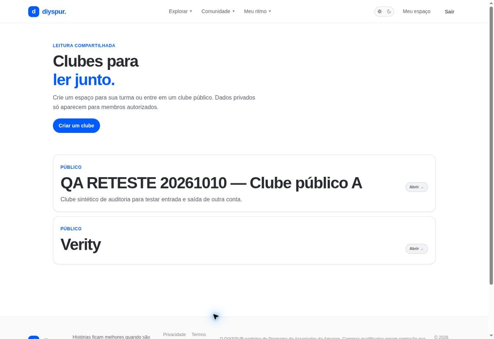

# Descobrir clubes / `/clubes`

## 1. Overview & Purpose

- **URL Path:** `/clubes`
- **Access Level:** Public / Authenticated
- **Core Purpose:** Encontrar espaços de leitura e abrir a ficha de um clube.

## 2. Prerequisites & Access

Sem conta para clubes públicos; privados exigem autorização. Login para criar ou participar.

## 3. UI Components & Layout

Introdução; Criar um clube; cards públicos/visíveis; nome, descrição e acesso à ficha.

*Captura real do estado disponível nesta rodada. Em telas administrativas, a imagem mostra o bloqueio de uma conta comum; não representa o editor autorizado.*

## 4. Step-by-Step User Flow

1. **Step 1:** Abra **Explorar → Clubes**.
2. **Step 2:** Compare nome e descrição e abra um clube visível.
3. **Step 3:** Na ficha, confira privacidade e ciclo antes de participar.
4. **Step 4:** Para organizar seu próprio espaço, use **Criar um clube**. Sem sessão, complete login e retorne à criação.

### Interação com o backend

getVisibleClubs consulta user_clubs com a visibilidade decidida por RLS; relação pessoal é consultada com user_club_members.

Os passos de salvamento acima descrevem o contrato implementado. Confirme a mensagem de sucesso antes de considerar uma operação persistida; sua execução nesta rodada está indicada abaixo.

## 5. Error Handling & Edge Cases

Clube privado pode não aparecer para quem não é autorizado. Um clube com nome igual ao livro não implica ciclo associado. Ausência de clubes não é motivo para criar registros fictícios em produção.

### Evidência e limite desta rodada

Dois clubes públicos visíveis, incluindo um clube QA antigo. Clube Verity sem ciclo associado.

Falhas de rede forçadas, comparação entre duas contas e matriz mobile/tablet não executadas nesta sessão. Layout responsivo foi revisado no CSS, sem certificação visual desses tamanhos. Consulte [cobertura QA](../03-qa-coverage.md).

### Referência de implementação

- [src/app/clubes/page.tsx](../../../src/app/clubes/page.tsx)
- [src/features/clubs/queries.ts](../../../src/features/clubs/queries.ts)

[Índice do manual](../00-overview.md) · [Primeiros passos](../01-getting-started.md) · [Referência técnica](../02-technical-reference.md)
