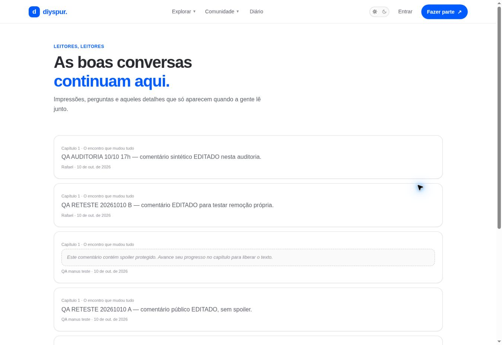

# Conversas da comunidade / `/comunidade`

## 1. Overview & Purpose

- **URL Path:** `/comunidade`
- **Access Level:** Public
- **Core Purpose:** Descobrir discussões com contexto do capítulo e proteção visual de spoiler.

## 2. Prerequisites & Access

Consulta pública do conteúdo autorizado; login para enviar denúncia ou participar na página do capítulo.

## 3. UI Components & Layout

Introdução; feed; link de contexto; texto/autoria/data; aviso de spoiler e revelação; denúncia.

*Captura desktop sem sessão. A imagem mostra o estado público ou o convite de acesso. As funções pessoais descritas exigem sessão.*

## 4. Step-by-Step User Flow

1. **Step 1:** Abra **Comunidade** pelo menu e leia o contexto de cada publicação.
2. **Step 2:** Antes de revelar um spoiler, confira o capítulo e sua posição na leitura.
3. **Step 3:** Clique no título do capítulo para abrir a discussão completa e participar com sua conta.
4. **Step 4:** Para reportar conteúdo inadequado, use **Denunciar** e descreva o motivo. Não use a denúncia para testar em conteúdo real sem uma finalidade de moderação.

### Interação com o backend

Feed consulta v_comments_visible e metadados autorizados dos capítulos/perfis. O componente de spoiler protege a apresentação; a visibilidade de dados depende das policies/view. Denúncia usa report_content.

Os passos de salvamento acima descrevem o contrato implementado. Confirme a mensagem de sucesso antes de considerar uma operação persistida; sua execução nesta rodada está indicada abaixo.

## 5. Error Handling & Edge Cases

Feed vazio e falha têm tratamento na página. Spoiler oculto exige ação de revelação. Não é uma tela de edição geral de posts. Comentários de testes anteriores continuam públicos e precisam de revisão editorial.

### Evidência e limite desta rodada

Feed renderizado com comentários e spoiler oculto. Registros QA de 10/10 visíveis; não criados nem removidos nesta rodada.

Falhas de rede forçadas, comparação entre duas contas e matriz mobile/tablet não executadas nesta sessão. Layout responsivo foi revisado no CSS, sem certificação visual desses tamanhos. Consulte [cobertura QA](../03-qa-coverage.md).

### Referência de implementação

- [src/app/comunidade/page.tsx](../../../src/app/comunidade/page.tsx)
- [src/components/comments/comment-spoiler-card.tsx](../../../src/components/comments/comment-spoiler-card.tsx)
- [src/features/moderation/actions.ts](../../../src/features/moderation/actions.ts)

[Índice do manual](../00-overview.md) · [Primeiros passos](../01-getting-started.md) · [Referência técnica](../02-technical-reference.md)
