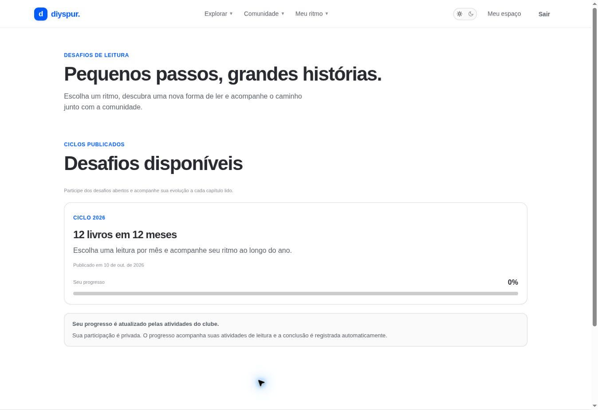

# Desafios de leitura / `/desafios`

## 1. Overview & Purpose

- **URL Path:** `/desafios`
- **Access Level:** Public / Authenticated
- **Core Purpose:** Descobrir desafios publicados e acompanhar a participação pessoal.

## 2. Prerequisites & Access

Sem conta para consultar desafios disponíveis; sessão para inscrição/progresso.

## 3. UI Components & Layout

Cards com ciclo, nome, proposta e publicação; botão de inscrição quando elegível; indicador percentual; avisos de privacidade.

*Captura real do estado disponível nesta rodada. Em telas administrativas, a imagem mostra o bloqueio de uma conta comum; não representa o editor autorizado.*

## 4. Step-by-Step User Flow

1. **Step 1:** Abra **Desafios** e leia a proposta do ciclo.
2. **Step 2:** Sem sessão, use o link de entrada para acompanhar progresso.
3. **Step 3:** Com sessão, escolha participar no desafio disponível e aguarde confirmação de inscrição.
4. **Step 4:** Continue suas atividades de leitura e consulte a porcentagem. A participação é privada; não é a sua posição no ranking.

### Interação com o backend

challenges publicados e user_challenges do titular. joinChallenge faz upsert com ignoreDuplicates em user_id,challenge_id para inscrição idempotente.

Os passos de salvamento acima descrevem o contrato implementado. Confirme a mensagem de sucesso antes de considerar uma operação persistida; sua execução nesta rodada está indicada abaixo.

## 5. Error Handling & Edge Cases

Sem desafio, a página orienta aguardar próximo ciclo. Falha de catálogo e falha de progresso possuem mensagens separadas. Não presumir nova inscrição quando a conta já participa.

### Evidência e limite desta rodada

Desafio 12 livros em 12 meses com progresso 0% na sessão existente; sem sessão listou proposta e link de login. Inscrição não executada.

Falhas de rede forçadas, comparação entre duas contas e matriz mobile/tablet não executadas nesta sessão. Layout responsivo foi revisado no CSS, sem certificação visual desses tamanhos. Consulte [cobertura QA](../03-qa-coverage.md).

### Referência de implementação

- [src/app/desafios/page.tsx](../../../src/app/desafios/page.tsx)
- [src/app/desafios/queries.ts](../../../src/app/desafios/queries.ts)
- [src/app/desafios/actions.ts](../../../src/app/desafios/actions.ts)
- [src/app/desafios/challenge-list.tsx](../../../src/app/desafios/challenge-list.tsx)

[Índice do manual](../00-overview.md) · [Primeiros passos](../01-getting-started.md) · [Referência técnica](../02-technical-reference.md)
