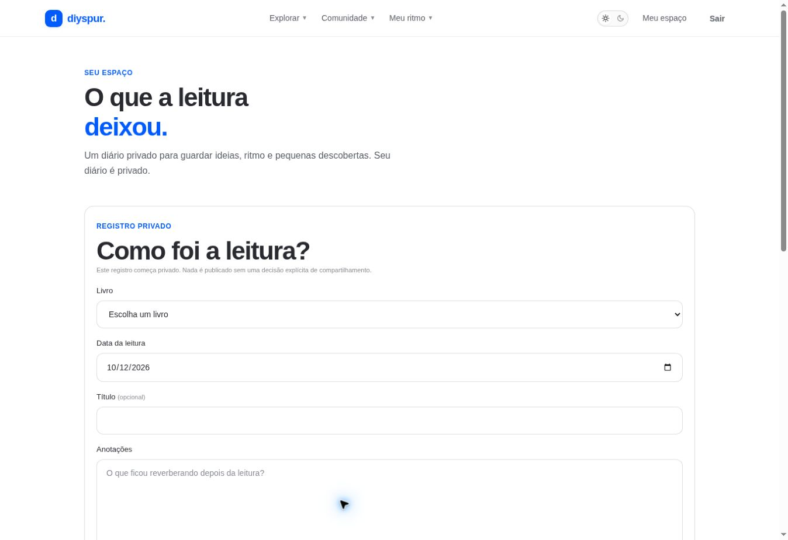

# Diário de leitura / `/diario`

## 1. Overview & Purpose

- **URL Path:** `/diario`
- **Access Level:** Authenticated
- **Core Purpose:** Guardar anotações privadas e medidas de uma sessão de leitura.

## 2. Prerequisites & Access

Sessão ativa; selecionar um livro existente; texto obrigatório.

## 3. UI Components & Layout

Formulário de registro; livro; data; título opcional; anotações; intervalo de páginas; minutos; porcentagem; spoiler; abas Ativos/Arquivados; registros e ação de arquivamento.

### Campos e regras

| Campo | Regra | Como usar |
|---|---|---|
| Livro | Obrigatório | Escolher no catálogo |
| Data | AAAA-MM-DD | Revise o dia pré-preenchido |
| Título | Opcional, até 160 caracteres | Identifica o registro |
| Anotações | Obrigatório, até 20.000 caracteres | Texto privado |
| Páginas | Inteiros positivos opcionais | Final maior ou igual à inicial |
| Minutos | 0–1440 | Duração da sessão |
| Progresso | 0–100, aceita decimal | Estimativa da leitura |
| Spoiler | Checkbox | Marca conteúdo; não publica o registro |

*Captura real do estado disponível nesta rodada. Em telas administrativas, a imagem mostra o bloqueio de uma conta comum; não representa o editor autorizado.*

## 4. Step-by-Step User Flow

1. **Step 1:** Abra **Diário de leitura** e selecione o livro.
2. **Step 2:** Confira **Data da leitura**; corrija-a se estiver registrando uma sessão anterior ou se o dia pré-preenchido não corresponder ao seu fuso.
3. **Step 3:** Escreva as **Anotações** e, se desejar, um título.
4. **Step 4:** Informe páginas inicial/final, minutos e porcentagem quando souber. Página final deve ser maior ou igual à inicial.
5. **Step 5:** Marque spoiler quando houver revelação de enredo e pressione **Salvar no diário**.
6. **Step 6:** A action cria o registro como **private**; aguarde Registro salvo no seu diário. Não há controle de publicar este registro no formulário atual.
7. **Step 7:** Para guardar um registro fora da lista ativa, use **Arquivar**. Abra **Arquivados** para consultar e **Restaurar** para voltar aos ativos.

### Interação com o backend

createJournalEntry insere reading_journal_entries com user_id derivado da sessão e visibility private. archive/restore altera archived_at com filtros id e user_id. Queries possuem paginação por cursor; a aba usa ?tab=arquivados.

Os passos de salvamento acima descrevem o contrato implementado. Confirme a mensagem de sucesso antes de considerar uma operação persistida; sua execução nesta rodada está indicada abaixo.

## 5. Error Handling & Edge Cases

Texto vazio, porcentagem fora de 0–100, minutos fora de 0–1440 e intervalo invertido são inválidos. Anotações aceitam até 20.000 caracteres. Salvar bem-sucedido reseta o formulário. A data inicial usa UTC no código; revisar perto da virada do dia em Brasília.

### Evidência e limite desta rodada

Formulário e registro privado QA existente observados; Arquivados mostrou vazio. Sem sessão, redirect contextual de login. Nenhuma criação/arquivamento executado.

Falhas de rede forçadas, comparação entre duas contas e matriz mobile/tablet não executadas nesta sessão. Layout responsivo foi revisado no CSS, sem certificação visual desses tamanhos. Consulte [cobertura QA](../03-qa-coverage.md).

### Referência de implementação

- [src/app/diario/page.tsx](../../../src/app/diario/page.tsx)
- [src/components/journal/journal-entry-form.tsx](../../../src/components/journal/journal-entry-form.tsx)
- [src/features/journal/actions.ts](../../../src/features/journal/actions.ts)
- [src/features/journal/queries.ts](../../../src/features/journal/queries.ts)

[Índice do manual](../00-overview.md) · [Primeiros passos](../01-getting-started.md) · [Referência técnica](../02-technical-reference.md)
