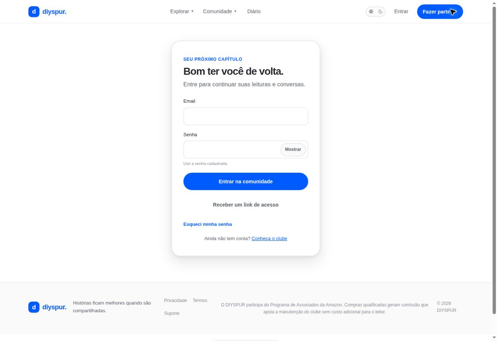

# Entrar na comunidade / `/entrar`

## 1. Overview & Purpose

- **URL Path:** `/entrar`
- **Access Level:** Public; redireciona autenticados
- **Core Purpose:** Acessar a conta por senha ou link de acesso e voltar à página solicitada.

## 2. Prerequisites & Access

Ter conta e acesso ao e-mail para link. Não compartilhar credenciais com outros leitores.

## 3. UI Components & Layout

Email; Senha; Mostrar/Ocultar; Entrar na comunidade; Receber um link de acesso; Esqueci minha senha; Conheça o clube; avisos de erro/status.

### Campos e regras

| Campo | Regra | Como usar |
|---|---|---|
| Email | Formato válido | Endereço da conta |
| Senha | 1–128 caracteres no login | Use a cadastrada; cadastro exige no mínimo 10 |

*Captura real do estado disponível nesta rodada. Em telas administrativas, a imagem mostra o bloqueio de uma conta comum; não representa o editor autorizado.*

## 4. Step-by-Step User Flow

1. **Step 1:** Abra **Entrar**. Se veio de uma página pessoal, confira o contexto de retorno.
2. **Step 2:** Informe seu e-mail e sua senha nos campos privados do formulário.
3. **Step 3:** Se necessário, use **Mostrar** para conferir a digitação e depois **Ocultar**.
4. **Step 4:** Clique em **Entrar na comunidade** e aguarde. Com sucesso, o site retorna ao destino local solicitado ou ao perfil.
5. **Step 5:** Para entrar sem senha, informe o e-mail e use **Receber um link de acesso**; abra o e-mail no ambiente adequado e siga o link.
6. **Step 6:** Se esqueceu a senha, use o link de recuperação. Se não tem conta, use **Conheça o clube**.

### Interação com o backend

signInWithPassword ou signInWithOtp no cliente Supabase. Callback usa exchangeCodeForSession. safeLocalRedirect restringe retorno à aplicação; cookies são renovados no proxy.

Os passos de salvamento acima descrevem o contrato implementado. Confirme a mensagem de sucesso antes de considerar uma operação persistida; sua execução nesta rodada está indicada abaixo.

## 5. Error Handling & Edge Cases

Envio vazio observado: Informe um email válido. Credenciais rejeitadas retornam Email ou senha não conferem; e-mail não confirmado pede confirmação; callback inválido orienta pedir outro acesso. Login social não é oferecido no formulário auditado.

### Evidência e limite desta rodada

Formulário público e erro de envio vazio observados. Login novo/magic link não realizados; sessão autenticada já existia no início da rodada.

Falhas de rede forçadas, comparação entre duas contas e matriz mobile/tablet não executadas nesta sessão. Layout responsivo foi revisado no CSS, sem certificação visual desses tamanhos. Consulte [cobertura QA](../03-qa-coverage.md).

### Referência de implementação

- [src/app/entrar/page.tsx](../../../src/app/entrar/page.tsx)
- [src/components/auth-form.tsx](../../../src/components/auth-form.tsx)
- [src/lib/safe-redirect.ts](../../../src/lib/safe-redirect.ts)
- [src/app/auth/callback/route.ts](../../../src/app/auth/callback/route.ts)

[Índice do manual](../00-overview.md) · [Primeiros passos](../01-getting-started.md) · [Referência técnica](../02-technical-reference.md)
