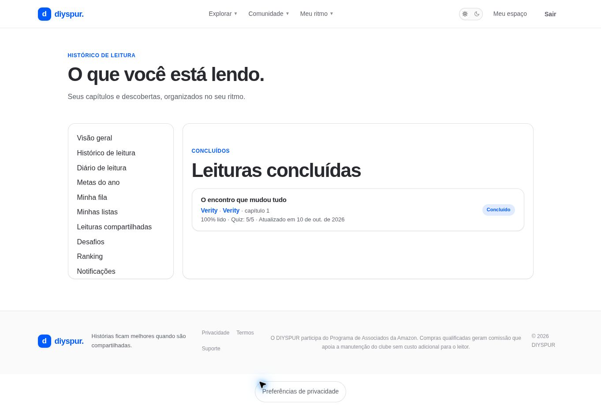

# Histórico de leitura / `/historico`

## 1. Overview & Purpose

- **URL Path:** `/historico`
- **Access Level:** Authenticated
- **Core Purpose:** Retomar capítulos e verificar conclusão e resultados de quiz.

## 2. Prerequisites & Access

Sessão ativa e atividades de leitura para uma lista preenchida.

## 3. UI Components & Layout

Navegação pessoal; seções de andamento/conclusão; títulos e links; porcentagem; quiz; data de atualização.

*Captura real do estado disponível nesta rodada. Em telas administrativas, a imagem mostra o bloqueio de uma conta comum; não representa o editor autorizado.*

## 4. Step-by-Step User Flow

1. **Step 1:** No perfil, clique em **Histórico de leitura** ou **Ver histórico →**.
2. **Step 2:** Identifique o status da leitura e o avanço registrado.
3. **Step 3:** Confira o resultado do quiz associado, quando existir, e a data de atualização.
4. **Step 4:** Abra o título do capítulo para continuar, ou o link do livro/temporada para contexto.

### Interação com o backend

getReadingHistory usa user_progress do titular e associa chapters, seasons, books e quiz_attempts autorizados.

Os passos de salvamento acima descrevem o contrato implementado. Confirme a mensagem de sucesso antes de considerar uma operação persistida; sua execução nesta rodada está indicada abaixo.

## 5. Error Handling & Edge Cases

Sem sessão redireciona preservando destino. Sem registros, o estado vazio convida a escolher uma leitura. Concluir uma etapa não significa concluir automaticamente todos os capítulos da obra.

### Evidência e limite desta rodada

Capítulo 1 concluído, 100% lido e quiz 5/5 observados; sem sessão houve redirect.

Falhas de rede forçadas, comparação entre duas contas e matriz mobile/tablet não executadas nesta sessão. Layout responsivo foi revisado no CSS, sem certificação visual desses tamanhos. Consulte [cobertura QA](../03-qa-coverage.md).

### Referência de implementação

- [src/app/historico/page.tsx](../../../src/app/historico/page.tsx)
- [src/features/profile/queries.ts](../../../src/features/profile/queries.ts)

[Índice do manual](../00-overview.md) · [Primeiros passos](../01-getting-started.md) · [Referência técnica](../02-technical-reference.md)
