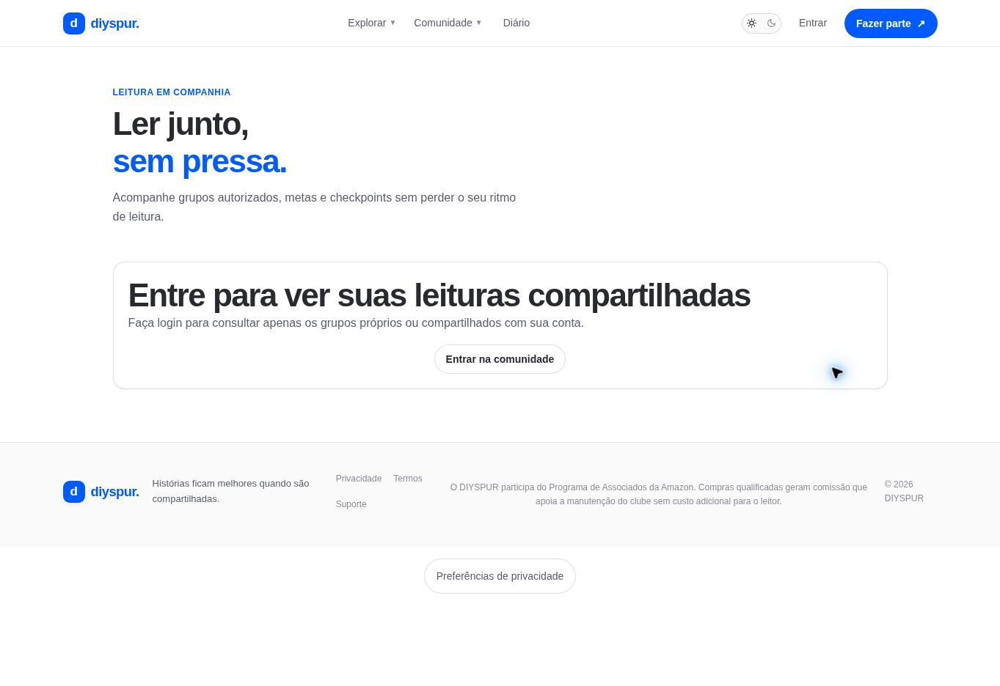

# Leituras compartilhadas / `/leituras-compartilhadas`

## 1. Overview & Purpose

- **URL Path:** `/leituras-compartilhadas`
- **Access Level:** Authenticated; shell público
- **Core Purpose:** Consultar grupos de leitura e seus checkpoints autorizados.

## 2. Prerequisites & Access

Sessão e vínculo de dono/membro/autorização para leituras privadas.

## 3. UI Components & Layout

Grupos; relação Você organiza/Você participa/Acesso autorizado; livro; período; limite de membros; metas por páginas/percentual/data; estado vazio.

*Captura desktop sem sessão. A imagem mostra o estado público ou o convite de acesso. As funções pessoais descritas exigem sessão.*

## 4. Step-by-Step User Flow

1. **Step 1:** Abra **Leituras compartilhadas** na área pessoal.
2. **Step 2:** Se houver grupos, confira sua relação com cada leitura e o livro associado.
3. **Step 3:** Leia os checkpoints na ordem das etapas e os limites de páginas, porcentagem ou data.
4. **Step 4:** Use o link do livro para consultar a obra. Sem grupos, explore livros ou clubes.
5. **Step 5:** A página atual é de consulta: não há formulário de criar grupo, convidar ou concluir checkpoint nesta rota. Solicite ao organizador a configuração/acesso pelo fluxo disponível da operação.

### Interação com o backend

Leituras em buddy_reads, vínculos em buddy_read_members e metas em buddy_read_checkpoints. Busca próprias, vínculos pessoais e privadas visíveis por RLS; associa books.

Os passos de salvamento acima descrevem o contrato implementado. Confirme a mensagem de sucesso antes de considerar uma operação persistida; sua execução nesta rodada está indicada abaixo.

## 5. Error Handling & Edge Cases

Sem sessão mostra login no próprio shell. Sem grupo mostra Nenhuma leitura compartilhada ainda. Erros de sessão, grupos, checkpoints ou livros têm mensagens distintas e opção de tentar novamente. Schema existente não comprova CRUD disponível na UI.

### Evidência e limite desta rodada

Estado vazio autenticado e convite de login sem sessão observados. Cenário com checkpoints não exercitado por ausência de grupo visível.

Falhas de rede forçadas, comparação entre duas contas e matriz mobile/tablet não executadas nesta sessão. Layout responsivo foi revisado no CSS, sem certificação visual desses tamanhos. Consulte [cobertura QA](../03-qa-coverage.md).

### Referência de implementação

- [src/app/leituras-compartilhadas/page.tsx](../../../src/app/leituras-compartilhadas/page.tsx)

[Índice do manual](../00-overview.md) · [Primeiros passos](../01-getting-started.md) · [Referência técnica](../02-technical-reference.md)
