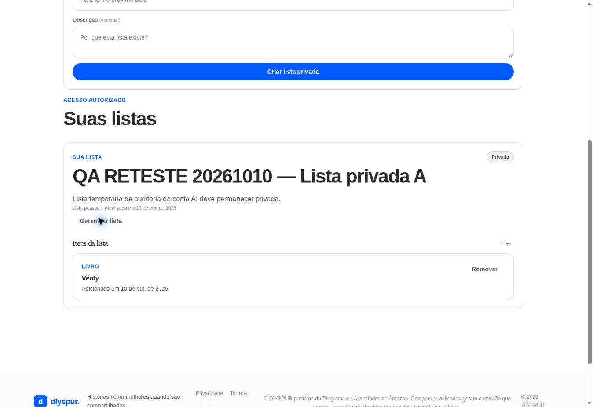

# Listas de leitura / `/listas`

## 1. Overview & Purpose

- **URL Path:** `/listas`
- **Access Level:** Authenticated; shell público
- **Core Purpose:** Organizar títulos em listas próprias e consultar conteúdo compartilhado autorizado.

## 2. Prerequisites & Access

Sessão para dados pessoais. Criação atual sempre privada; adicionar um livro pela ficha dele.

## 3. UI Components & Layout

Criar lista; nome; descrição; listas autorizadas; itens; Gerenciar lista; editor; Remover; restauração quando oferecida.

### Campos e regras

| Campo | Regra | Como usar |
|---|---|---|
| Nome | 1–80 caracteres | Obrigatório |
| Descrição | Até 500 caracteres | Opcional |
| Guardar em | Lista do titular | Usado na ficha do livro |

*Captura real do estado disponível nesta rodada. Em telas administrativas, a imagem mostra o bloqueio de uma conta comum; não representa o editor autorizado.*

## 4. Step-by-Step User Flow

1. **Step 1:** Abra **Minhas listas** na área pessoal.
2. **Step 2:** Preencha **Nome da lista** e opcionalmente **Descrição**; use **Criar lista privada** e aguarde a confirmação.
3. **Step 3:** Abra uma ficha de livro, selecione a lista em **Guardar em** e clique em **Adicionar**.
4. **Step 4:** Retorne às listas e confira os itens. Clique no livro para abrir sua ficha.
5. **Step 5:** Em lista própria, use **Gerenciar lista**, altere nome/descrição e pressione **Salvar lista**; **Fechar gestão** apenas fecha os campos.
6. **Step 6:** Use **Remover** no item quando não quiser mantê-lo na seleção. Backend possui remoção/restauração de item; não confundir com exclusão da conta ou da obra.

### Interação com o backend

reading_lists e reading_list_items; create insere owner_id, private e is_collaborative false. add_book_to_reading_list adiciona livro; update exige owner_id; remove_reading_list_item/restore_reading_list_item tratam item. reorder_reading_list existe na action, mas não deve ser prometido como drag-and-drop sem controle visível.

Os passos de salvamento acima descrevem o contrato implementado. Confirme a mensagem de sucesso antes de considerar uma operação persistida; sua execução nesta rodada está indicada abaixo.

## 5. Error Handling & Edge Cases

Nome até 80 e descrição até 500 caracteres. Sem sessão, shell pede login em vez de necessariamente redirecionar. Duplicação, sem acesso e conflito de versão têm feedback. Criação privada não oferece seletor de publicação/colaboração no formulário atual.

### Evidência e limite desta rodada

Lista QA privada existente com Verity; gestão abriu nome, descrição, Salvar lista e Fechar gestão. Sem sessão, Entre para ver suas listas. Nenhuma alteração salva.

Falhas de rede forçadas, comparação entre duas contas e matriz mobile/tablet não executadas nesta sessão. Layout responsivo foi revisado no CSS, sem certificação visual desses tamanhos. Consulte [cobertura QA](../03-qa-coverage.md).

### Referência de implementação

- [src/app/listas/page.tsx](../../../src/app/listas/page.tsx)
- [src/components/lists/list-management.tsx](../../../src/components/lists/list-management.tsx)
- [src/features/lists/actions.ts](../../../src/features/lists/actions.ts)

[Índice do manual](../00-overview.md) · [Primeiros passos](../01-getting-started.md) · [Referência técnica](../02-technical-reference.md)
