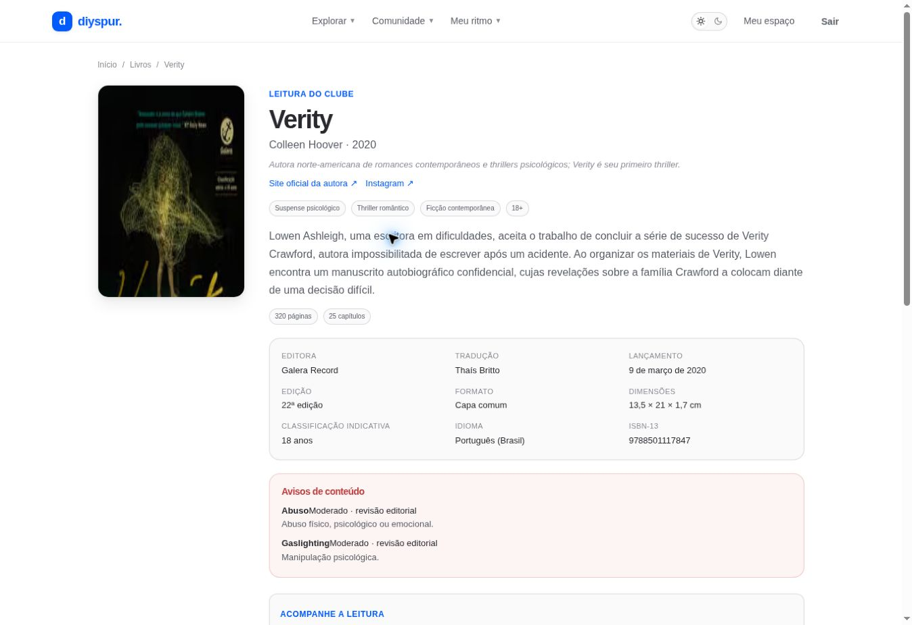

# Ficha do livro / `/livros/[slug]`

## 1. Overview & Purpose

- **URL Path:** `/livros/[slug]`
- **Access Level:** Public
- **Core Purpose:** Entender a obra, a edição, os avisos de conteúdo e as temporadas, e guardar o título na organização pessoal.

## 2. Prerequisites & Access

Livro visível no catálogo. Sessão ativa para adicionar à fila ou a uma lista; crie antes uma lista em /listas.

## 3. UI Components & Layout

Breadcrumbs; capa; autor e biografia; links externos; sinopse; tags; dados editoriais; avisos; painel do exemplar; compartilhamento; fila; seletor de lista; temporadas.

*Captura real do estado disponível nesta rodada. Em telas administrativas, a imagem mostra o bloqueio de uma conta comum; não representa o editor autorizado.*

## 4. Step-by-Step User Flow

1. **Step 1:** No catálogo, abra o livro e confira título, autor, edição, idioma e ISBN. As páginas indicadas pertencem à edição cadastrada.
2. **Step 2:** Leia os **Avisos de conteúdo** antes de iniciar; a ausência de avisos não é garantia de ausência de temas sensíveis.
3. **Step 3:** Tenha seu exemplar físico ou digital. **Comprar exemplar na Amazon** abre um redirecionamento afiliado; não é necessário comprar para usar o clube.
4. **Step 4:** Com sessão ativa, pressione o botão para adicionar à fila; uma confirmação indica o resultado. A fila aceita até cinco títulos.
5. **Step 5:** Em **Guardar em**, selecione uma lista e clique em **Adicionar**. Se nenhuma lista existir, abra o link para criar uma lista privada.
6. **Step 6:** Clique na temporada desejada em **Temporadas e capítulos**. Caso não exista, acompanhe a ficha até a curadoria abrir um ciclo.
7. **Step 7:** Para compartilhar a ficha, use **Convidar amigos para ler … juntos**; o componente usa compartilhamento nativo quando disponível e cópia do endereço como alternativa. Isso não cria convite de clube.

### Interação com o backend

getBook lê books, authors, seasons, book_content_warnings/content_warnings e listas do titular. addToUpNext chama add_to_up_next_atomic; adicionar à lista usa add_book_to_reading_list. /api/affiliate/[slug] valida o destino e registra clique antes do redirect.

Os passos de salvamento acima descrevem o contrato implementado. Confirme a mensagem de sucesso antes de considerar uma operação persistida; sua execução nesta rodada está indicada abaixo.

## 5. Error Handling & Edge Cases

Slug inexistente ou getBook sem resultado leva a notFound. Capa ausente recebe placeholder; metadados nulos são omitidos. Sem sessão, fila oferece login. Lista vazia oferece criação. Livro sem temporada não permite iniciar uma temporada inexistente. Compartilhamento depende das permissões e recursos do dispositivo.

### Evidência e limite desta rodada

Verity renderizada com dados editoriais, dois avisos e temporada. O massacre da família Hope renderizado sem temporada. Escritas de fila/lista e redirecionamento Amazon não executados nesta rodada.

Falhas de rede forçadas, comparação entre duas contas e matriz mobile/tablet não executadas nesta sessão. Layout responsivo foi revisado no CSS, sem certificação visual desses tamanhos. Consulte [cobertura QA](../03-qa-coverage.md).

### Referência de implementação

- [src/app/livros/[slug]/page.tsx](../../../src/app/livros/[slug]/page.tsx)
- [src/components/books/share-book-button.tsx](../../../src/components/books/share-book-button.tsx)
- [src/features/up-next/actions.ts](../../../src/features/up-next/actions.ts)
- [src/features/lists/actions.ts](../../../src/features/lists/actions.ts)
- [src/features/catalog/queries.ts](../../../src/features/catalog/queries.ts)

[Índice do manual](../00-overview.md) · [Primeiros passos](../01-getting-started.md) · [Referência técnica](../02-technical-reference.md)
