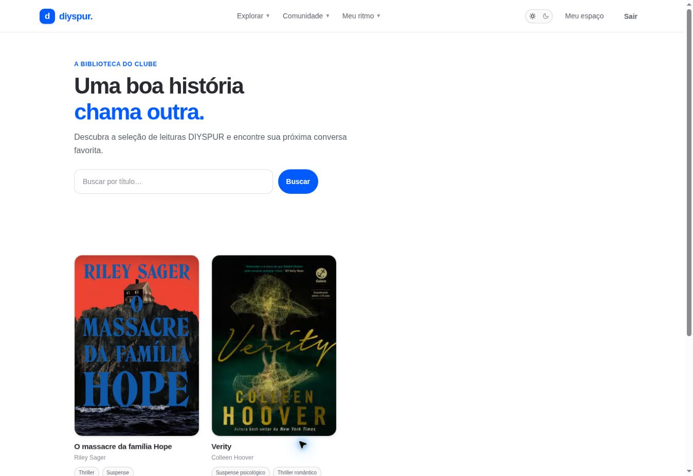

# Catálogo de livros / `/livros`

## 1. Overview & Purpose

- **URL Path:** `/livros`
- **Access Level:** Public
- **Core Purpose:** Descobrir o acervo e localizar títulos por nome.

## 2. Prerequisites & Access

Sem autenticação. A busca atual é por título, não por autor ou ISBN.

## 3. UI Components & Layout

Introdução; campo Buscar livros por título; botão Buscar; cards de capa e autor; resultado da busca e opção para limpar.

### Campos e regras

| Campo | Regra | Como usar |
|---|---|---|
| Buscar livros por título | Texto livre | Filtra apenas título; termo vazio retorna catálogo |

*Captura real do estado disponível nesta rodada. Em telas administrativas, a imagem mostra o bloqueio de uma conta comum; não representa o editor autorizado.*

## 4. Step-by-Step User Flow

1. **Step 1:** Acesse **Explorar → Livros** ou **Explorar acervo de livros** na home.
2. **Step 2:** Digite parte do título no campo **Buscar livros por título** e pressione **Buscar**.
3. **Step 3:** O endereço recebe o parâmetro q; a página carrega o conjunto correspondente. Você pode guardar esse endereço para voltar à mesma pesquisa.
4. **Step 4:** Abra o card do livro para consultar a ficha. Se não houver resultados, use **Limpar busca** ou **Ver catálogo**.

### Interação com o backend

getBooks aplica ilike em books.title, ordena por created_at e limita a 36 registros; associa authors por author_id. Caracteres %, vírgula e parênteses são removidos do termo no servidor.

Os passos de salvamento acima descrevem o contrato implementado. Confirme a mensagem de sucesso antes de considerar uma operação persistida; sua execução nesta rodada está indicada abaixo.

## 5. Error Handling & Edge Cases

Loading observado: Carregando leituras… / Preparando a estante. Busca sem correspondência mostra Nenhum título por aqui ainda. getBooks retorna [] também diante de falha do banco, tornando erro e resultado vazio indistinguíveis nesta camada. Não há paginação do catálogo nesta query.

### Evidência e limite desta rodada

Dois títulos no catálogo. Busca zzqa-inexistente executada no navegador: q na URL, estado vazio e Limpar busca visíveis.

Falhas de rede forçadas, comparação entre duas contas e matriz mobile/tablet não executadas nesta sessão. Layout responsivo foi revisado no CSS, sem certificação visual desses tamanhos. Consulte [cobertura QA](../03-qa-coverage.md).

### Referência de implementação

- [src/app/livros/page.tsx](../../../src/app/livros/page.tsx)
- [src/components/catalog/book-search.tsx](../../../src/components/catalog/book-search.tsx)
- [src/features/catalog/queries.ts](../../../src/features/catalog/queries.ts)

[Índice do manual](../00-overview.md) · [Primeiros passos](../01-getting-started.md) · [Referência técnica](../02-technical-reference.md)
