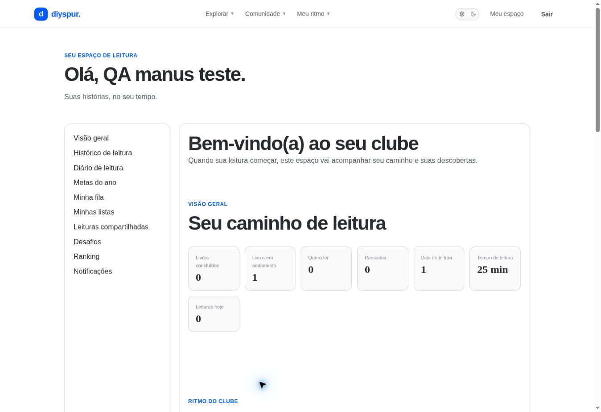

# Meu espaço / `/perfil`

## 1. Overview & Purpose

- **URL Path:** `/perfil`
- **Access Level:** Authenticated
- **Core Purpose:** Reunir indicadores pessoais, leituras recentes, quizzes, conquistas e acesso aos dados.

## 2. Prerequisites & Access

Conta autenticada. Indicadores dependem de atividades já registradas.

## 3. UI Components & Layout

Saudação; navegação pessoal com dez links; visão geral; XP/sequência; quiz; atividade recente; conquistas; exportação JSON; privacidade.

*Captura real do estado disponível nesta rodada. Em telas administrativas, a imagem mostra o bloqueio de uma conta comum; não representa o editor autorizado.*

## 4. Step-by-Step User Flow

1. **Step 1:** Entre na sua conta e abra **Meu espaço**.
2. **Step 2:** Confira livros concluídos/em andamento, dias e tempo de leitura. Essas métricas são diferentes da porcentagem de um capítulo.
3. **Step 3:** Consulte XP da temporada, XP total, sequência e estatísticas de quiz.
4. **Step 4:** Abra uma leitura recente para continuar; use **Ver histórico →** para consultar todas as leituras retornadas.
5. **Step 5:** Use os links da área pessoal para diário, metas, fila, listas, grupos, desafios, ranking e notificações.
6. **Step 6:** Se precisar de cópia dos registros, use **Exportar meus dados (JSON) ↓**. Guarde o arquivo em local privado e leia as limitações da exportação na referência técnica.

### Interação com o backend

getProfileOverview associa profiles, v_user_reading_overview, user_xp, user_streaks, user_quiz_averages, user_achievements/achievements e user_progress. Exportação GET /api/account/export filtra registros pelo titular.

Os passos de salvamento acima descrevem o contrato implementado. Confirme a mensagem de sucesso antes de considerar uma operação persistida; sua execução nesta rodada está indicada abaixo.

## 5. Error Handling & Edge Cases

Sem sessão redireciona ao login. Alguns indicadores podem usar valores padrão diante de ausência de dados. Exportação atual possui limites e não verifica cada error de PostgREST; não chamar de cópia integral garantida. Não existe tela /settings dedicada no mapa atual.

### Evidência e limite desta rodada

Perfil carregado com atividade existente, 305 XP e um capítulo concluído. Também exibiu texto de boas-vindas orientado a quem ainda não começou; ponto de UX registrado. Exportação não baixada.

Falhas de rede forçadas, comparação entre duas contas e matriz mobile/tablet não executadas nesta sessão. Layout responsivo foi revisado no CSS, sem certificação visual desses tamanhos. Consulte [cobertura QA](../03-qa-coverage.md).

### Referência de implementação

- [src/app/perfil/page.tsx](../../../src/app/perfil/page.tsx)
- [src/features/profile/queries.ts](../../../src/features/profile/queries.ts)
- [src/app/api/account/export/route.ts](../../../src/app/api/account/export/route.ts)

[Índice do manual](../00-overview.md) · [Primeiros passos](../01-getting-started.md) · [Referência técnica](../02-technical-reference.md)
