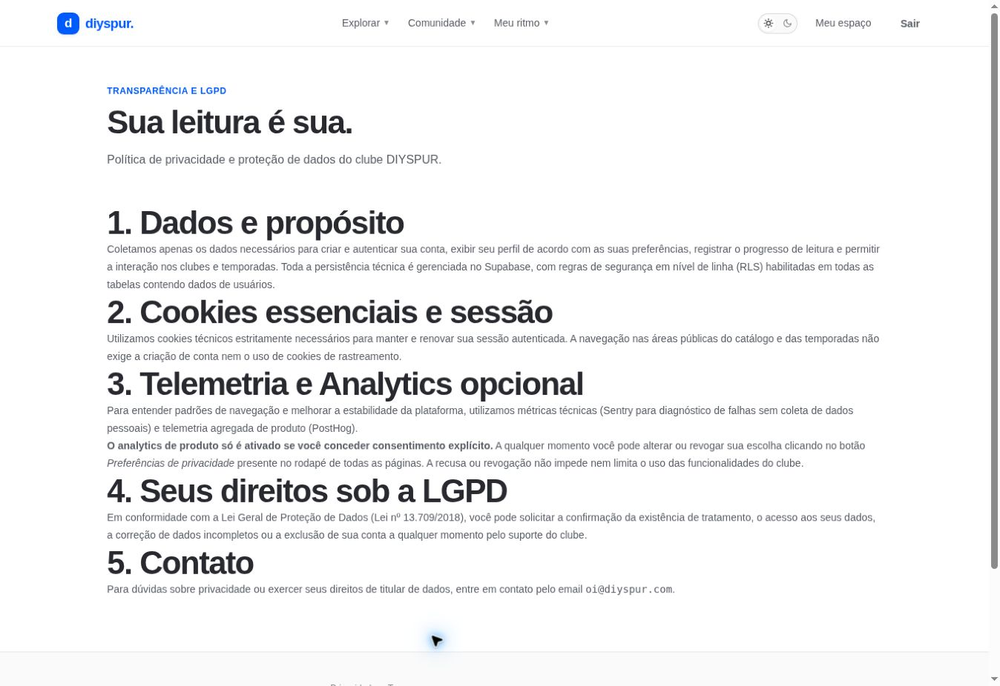

# Privacidade e preferências / `/privacidade`

## 1. Overview & Purpose

- **URL Path:** `/privacidade`
- **Access Level:** Public
- **Core Purpose:** Explicar tratamento de dados e permitir consultar orientações de privacidade.

## 2. Prerequisites & Access

Nenhuma sessão. Exportação pessoal exige login no perfil.

## 3. UI Components & Layout

Dados e propósito; cookies; analytics opcional; direitos; contato; Preferências de privacidade no rodapé.

*Captura real do estado disponível nesta rodada. Em telas administrativas, a imagem mostra o bloqueio de uma conta comum; não representa o editor autorizado.*

## 4. Step-by-Step User Flow

1. **Step 1:** Abra **Privacidade** no rodapé e leia as categorias de dados e finalidades.
2. **Step 2:** Para revisar analytics, use **Preferências de privacidade** no rodapé.
3. **Step 3:** Escolha aceitar ou recusar conforme sua preferência. Recusa não bloqueia a navegação do clube.
4. **Step 4:** Para exportar registros próprios, acesse o perfil autenticado. Para correção/exclusão de conta, utilize o contato publicado; não existe botão de exclusão nesta tela.

### Interação com o backend

Conteúdo estático; banner gerencia escolha de analytics no cliente. PostHog depende de consentimento na integração. A inspeção visual não é auditoria de todo tráfego de telemetria.

Os passos de salvamento acima descrevem o contrato implementado. Confirme a mensagem de sucesso antes de considerar uma operação persistida; sua execução nesta rodada está indicada abaixo.

## 5. Error Handling & Edge Cases

A existência de RLS não comprova por si só conformidade integral ou ausência de vazamento. Não há controle de exclusão/correção de conta nesta página. Regras e dados atuais devem ser conferidos antes de publicar afirmações abrangentes.

### Evidência e limite desta rodada

Política renderizada; recusa de analytics executada no início sem impedir navegação. Captura de tráfego e auditoria jurídica não realizadas.

Falhas de rede forçadas, comparação entre duas contas e matriz mobile/tablet não executadas nesta sessão. Layout responsivo foi revisado no CSS, sem certificação visual desses tamanhos. Consulte [cobertura QA](../03-qa-coverage.md).

### Referência de implementação

- [src/app/privacidade/page.tsx](../../../src/app/privacidade/page.tsx)
- [src/components/analytics/analytics-consent-banner.tsx](../../../src/components/analytics/analytics-consent-banner.tsx)

[Índice do manual](../00-overview.md) · [Primeiros passos](../01-getting-started.md) · [Referência técnica](../02-technical-reference.md)
