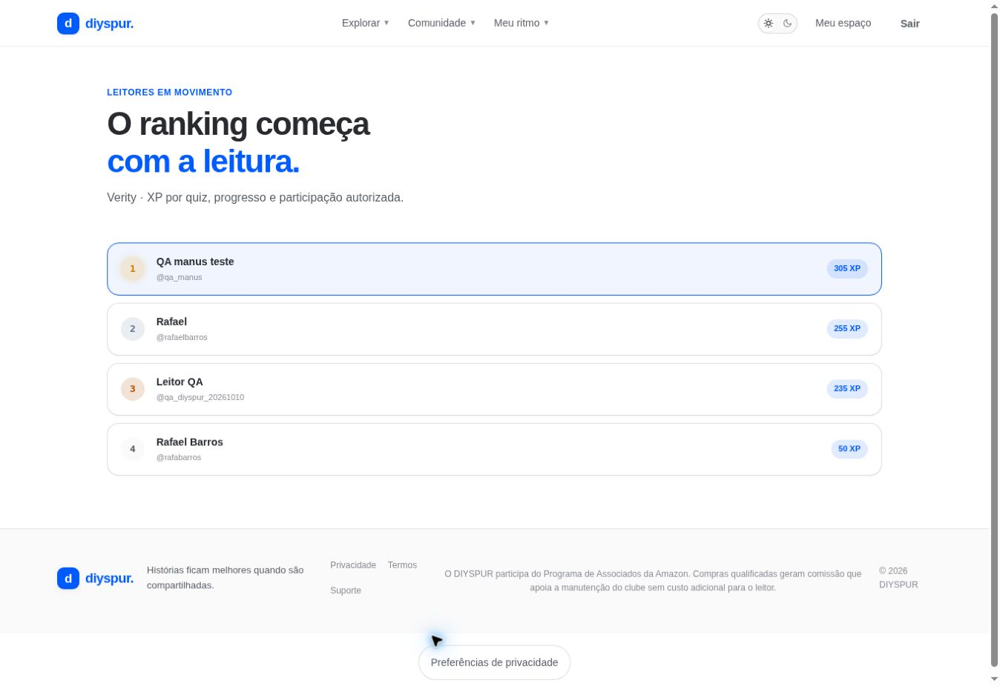

# Ranking da temporada / `/ranking`

## 1. Overview & Purpose

- **URL Path:** `/ranking`
- **Access Level:** Authenticated
- **Core Purpose:** Consultar posições por XP na temporada ativa.

## 2. Prerequisites & Access

Sessão ativa e temporada ativa com atividades para uma lista preenchida.

## 3. UI Components & Layout

Nome da temporada; lista ordenada; posição, nome/@usuário e XP; destaque da conta atual.

*Captura real do estado disponível nesta rodada. Em telas administrativas, a imagem mostra o bloqueio de uma conta comum; não representa o editor autorizado.*

## 4. Step-by-Step User Flow

1. **Step 1:** Abra **Ranking** pela área pessoal.
2. **Step 2:** Confira a temporada que está sendo comparada.
3. **Step 3:** Leia a posição e o XP; a lista é da temporada e não necessariamente o XP total da conta.
4. **Step 4:** Volte à leitura para continuar suas atividades. A página é de consulta e não oferece alteração manual de score ou posição.

### Interação com o backend

Consulta seasons active e v_season_ranking, ordenada por position e limitada a 50; XP é calculado por operações autorizadas no backend.

Os passos de salvamento acima descrevem o contrato implementado. Confirme a mensagem de sucesso antes de considerar uma operação persistida; sua execução nesta rodada está indicada abaixo.

## 5. Error Handling & Edge Cases

Sem sessão redireciona. Sem temporada ou atividades mostra estado vazio. Falha de query exibe aviso para atualizar. Posição não mede qualidade de leitura; considerar o ranking uma referência de participação.

### Evidência e limite desta rodada

Quatro leitores listados na temporada Verity com XP, conta atual destacada pelo componente. Sem sessão redirecionou.

Falhas de rede forçadas, comparação entre duas contas e matriz mobile/tablet não executadas nesta sessão. Layout responsivo foi revisado no CSS, sem certificação visual desses tamanhos. Consulte [cobertura QA](../03-qa-coverage.md).

### Referência de implementação

- [src/app/ranking/page.tsx](../../../src/app/ranking/page.tsx)

[Índice do manual](../00-overview.md) · [Primeiros passos](../01-getting-started.md) · [Referência técnica](../02-technical-reference.md)
