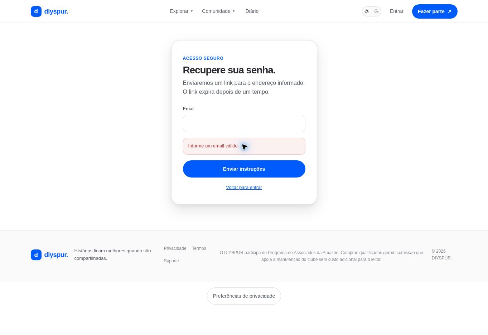

# Recuperar acesso / `/recuperar-senha`

## 1. Overview & Purpose

- **URL Path:** `/recuperar-senha`
- **Access Level:** Public
- **Core Purpose:** Solicitar instruções para recuperar a senha sem revelar se uma conta existe.

## 2. Prerequisites & Access

Acesso à caixa de e-mail cadastrada.

## 3. UI Components & Layout

Email; Enviar instruções; feedback; Voltar para entrar.

*Captura real do estado disponível nesta rodada. Em telas administrativas, a imagem mostra o bloqueio de uma conta comum; não representa o editor autorizado.*

## 4. Step-by-Step User Flow

1. **Step 1:** Em Entrar, clique em **Esqueci minha senha**.
2. **Step 2:** Informe seu e-mail e use **Enviar instruções**.
3. **Step 3:** A mensagem de sucesso é genérica: se existir conta, serão enviadas instruções. Ela não prova existência da conta nem entrega do e-mail.
4. **Step 4:** Abra o link recebido antes de expirar; o callback encaminha à atualização de senha.
5. **Step 5:** Se o link não funcionar, solicite outro pelo mesmo formulário.

### Interação com o backend

resetPasswordForEmail com redirectTo /auth/callback e next local de /atualizar-senha; destino anterior é preservado.

Os passos de salvamento acima descrevem o contrato implementado. Confirme a mensagem de sucesso antes de considerar uma operação persistida; sua execução nesta rodada está indicada abaixo.

## 5. Error Handling & Edge Cases

Campo vazio gera Informe um email válido observado. Falha de serviço mostra Não foi possível solicitar a recuperação agora. Tente novamente. Expiração depende da configuração; não definir prazo sem confirmação.

### Evidência e limite desta rodada

Envio vazio validado, sem disparo de e-mail. Entrega e uso de link não exercitados.

Falhas de rede forçadas, comparação entre duas contas e matriz mobile/tablet não executadas nesta sessão. Layout responsivo foi revisado no CSS, sem certificação visual desses tamanhos. Consulte [cobertura QA](../03-qa-coverage.md).

### Referência de implementação

- [src/app/recuperar-senha/page.tsx](../../../src/app/recuperar-senha/page.tsx)
- [src/components/recover-password-form.tsx](../../../src/components/recover-password-form.tsx)
- [src/app/auth/callback/route.ts](../../../src/app/auth/callback/route.ts)

[Índice do manual](../00-overview.md) · [Primeiros passos](../01-getting-started.md) · [Referência técnica](../02-technical-reference.md)
