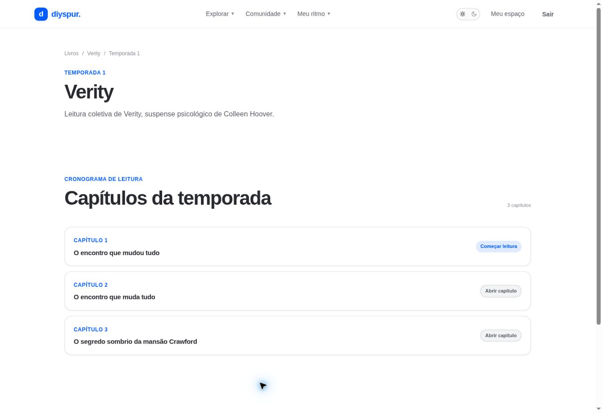

# Temporada e cronograma / `/temporadas/[slug]`

## 1. Overview & Purpose

- **URL Path:** `/temporadas/[slug]`
- **Access Level:** Public; conteúdo condicionado
- **Core Purpose:** Organizar a leitura coletiva em etapas e mostrar quais capítulos podem ser abertos.

## 2. Prerequisites & Access

Temporada active ou finished visível. Capítulos posteriores podem exigir tentativa do quiz anterior vinculada à sua conta.

## 3. UI Components & Layout

Breadcrumbs; título e descrição; cronograma; capítulos abertos; cartões bloqueados; marcos quando aplicáveis.

*Captura real do estado disponível nesta rodada. Em telas administrativas, a imagem mostra o bloqueio de uma conta comum; não representa o editor autorizado.*

## 4. Step-by-Step User Flow

1. **Step 1:** Abra uma temporada na ficha de livro ou na home.
2. **Step 2:** Leia o cronograma. O número da etapa do clube pode representar um trecho maior que um capítulo do exemplar.
3. **Step 3:** Clique em **Começar leitura** ou **Abrir capítulo** na etapa disponível.
4. **Step 4:** Se a etapa estiver bloqueada por quiz, abra a etapa anterior, entre na sua conta e faça a tentativa do quiz.
5. **Step 5:** Volte ao cronograma para verificar o acesso. Não tente usar apenas o endereço de uma etapa bloqueada: o servidor verifica a mesma regra.

### Interação com o backend

getSeason lê seasons/books/chapters/milestones; get_season_chapter_access fornece metadados de acesso; get_user_milestone_status fornece status autorizado. Títulos são normalizados para evitar repetição Capítulo X.

Os passos de salvamento acima descrevem o contrato implementado. Confirme a mensagem de sucesso antes de considerar uma operação persistida; sua execução nesta rodada está indicada abaixo.

## 5. Error Handling & Edge Cases

Temporada ausente, não visível ou não ativa/finalizada resulta em notFound. Datas futuras e gate por quiz são regras diferentes. Capítulos bloqueados não exibem conteúdo completo. Sem sessão, a timeline pode informar o bloqueio e pedir login na página do capítulo.

### Evidência e limite desta rodada

Timeline Verity com três etapas abertas na sessão existente; sem sessão, capítulo 1 aberto e capítulos 2/3 bloqueados.

Falhas de rede forçadas, comparação entre duas contas e matriz mobile/tablet não executadas nesta sessão. Layout responsivo foi revisado no CSS, sem certificação visual desses tamanhos. Consulte [cobertura QA](../03-qa-coverage.md).

### Referência de implementação

- [src/app/temporadas/[slug]/page.tsx](../../../src/app/temporadas/[slug]/page.tsx)
- [src/features/catalog/queries.ts](../../../src/features/catalog/queries.ts)
- [src/lib/chapter-label.ts](../../../src/lib/chapter-label.ts)

[Índice do manual](../00-overview.md) · [Primeiros passos](../01-getting-started.md) · [Referência técnica](../02-technical-reference.md)
