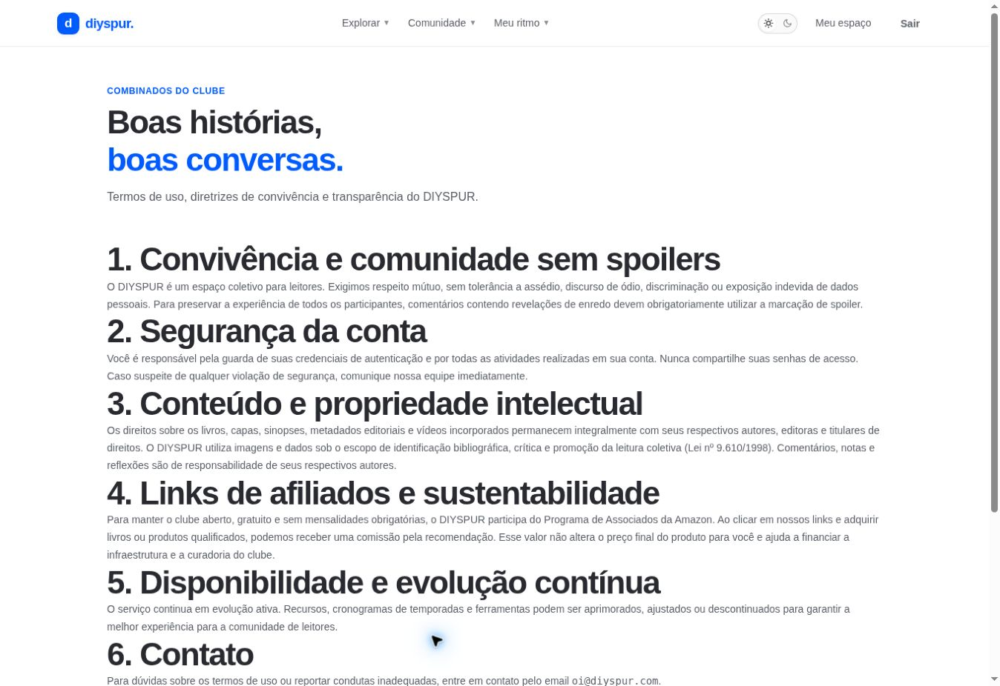

# Termos e convivência / `/termos`

## 1. Overview & Purpose

- **URL Path:** `/termos`
- **Access Level:** Public
- **Core Purpose:** Consultar regras de uso, segurança da conta, propriedade intelectual e transparência de afiliados.

## 2. Prerequisites & Access

Nenhuma sessão necessária.

## 3. UI Components & Layout

Seis seções de conteúdo e contato; rodapé comum.

*Captura real do estado disponível nesta rodada. Em telas administrativas, a imagem mostra o bloqueio de uma conta comum; não representa o editor autorizado.*

## 4. Step-by-Step User Flow

1. **Step 1:** Abra **Termos** no rodapé.
2. **Step 2:** Leia as regras de respeito e marcação de spoiler antes de comentar.
3. **Step 3:** Confira responsabilidades sobre conta, conteúdo, links afiliados e disponibilidade.
4. **Step 4:** Para dúvida sobre as regras, use o contato publicado. A tela não é um formulário de denúncia nem contém ação de aceitar contrato.

### Interação com o backend

Conteúdo da página estático no frontend; abrir a página não grava aceite em tabela.

Os passos de salvamento acima descrevem o contrato implementado. Confirme a mensagem de sucesso antes de considerar uma operação persistida; sua execução nesta rodada está indicada abaixo.

## 5. Error Handling & Edge Cases

Não confundir a exposição do texto com validação jurídica ou registro de consentimento. Canal de contato canônico mostrado: oi@diyspur.com.

### Evidência e limite desta rodada

Conteúdo e contato renderizados. Manual descreve a tela, sem avaliar validade jurídica.

Falhas de rede forçadas, comparação entre duas contas e matriz mobile/tablet não executadas nesta sessão. Layout responsivo foi revisado no CSS, sem certificação visual desses tamanhos. Consulte [cobertura QA](../03-qa-coverage.md).

### Referência de implementação

- [src/app/termos/page.tsx](../../../src/app/termos/page.tsx)

[Índice do manual](../00-overview.md) · [Primeiros passos](../01-getting-started.md) · [Referência técnica](../02-technical-reference.md)
