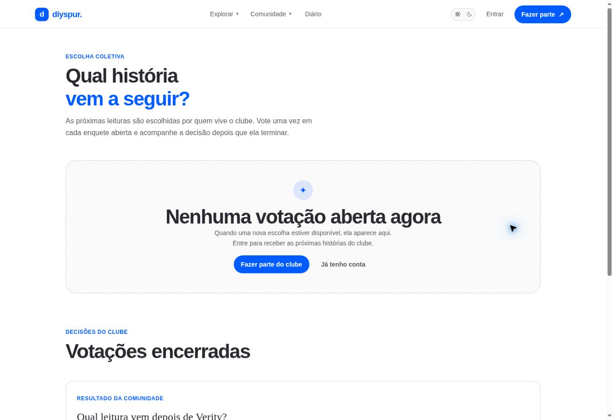

# Votação da próxima leitura / `/votacao`

## 1. Overview & Purpose

- **URL Path:** `/votacao`
- **Access Level:** Public / Authenticated
- **Core Purpose:** Permitir escolhas coletivas e consultar decisões anteriores.

## 2. Prerequisites & Access

Sem conta para resultados disponíveis; sessão e enquete aberta para votar.

## 3. UI Components & Layout

Introdução; enquetes abertas ou estado vazio; alternativas; confirmação; resultados encerrados com total e percentuais.

*Captura desktop sem sessão. A imagem mostra o estado público ou o convite de acesso. As funções pessoais descritas exigem sessão.*

## 4. Step-by-Step User Flow

1. **Step 1:** Abra a página de votação e confira se existe uma enquete aberta.
2. **Step 2:** Quando houver enquete aberta, entre na sua conta e escolha uma alternativa.
3. **Step 3:** Envie o voto pela ação da enquete e aguarde confirmação; a regra informada é um voto por enquete.
4. **Step 4:** Após o encerramento, consulte os resultados e o total de votos. Na ausência de enquete, use **Continuar minhas leituras**.

### Interação com o backend

getPublicPolls/getClosedPolls leem book_polls e book_poll_options; castPollVote invoca vote-next-book. Escrita e regras temporais são verificadas no backend, não por esconder um botão.

Os passos de salvamento acima descrevem o contrato implementado. Confirme a mensagem de sucesso antes de considerar uma operação persistida; sua execução nesta rodada está indicada abaixo.

## 5. Error Handling & Edge Cases

Nenhuma enquete aberta é estado normal. Não há como testar novo voto usando uma votação encerrada. Falha de envio não significa voto confirmado; revise o feedback antes de repetir. Resultados com poucos votos são apenas a amostra atual.

### Evidência e limite desta rodada

Nenhuma votação aberta; uma votação encerrada com um voto e resultado agregado. Novo voto não executado porque não havia enquete aberta.

Falhas de rede forçadas, comparação entre duas contas e matriz mobile/tablet não executadas nesta sessão. Layout responsivo foi revisado no CSS, sem certificação visual desses tamanhos. Consulte [cobertura QA](../03-qa-coverage.md).

### Referência de implementação

- [src/app/votacao/page.tsx](../../../src/app/votacao/page.tsx)
- [src/features/polls/queries.ts](../../../src/features/polls/queries.ts)
- [src/features/polls/actions.ts](../../../src/features/polls/actions.ts)
- [src/components/polls/poll-card.tsx](../../../src/components/polls/poll-card.tsx)

[Índice do manual](../00-overview.md) · [Primeiros passos](../01-getting-started.md) · [Referência técnica](../02-technical-reference.md)
